<div align="center">

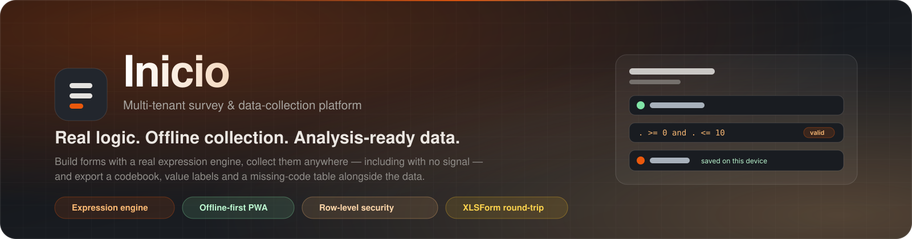

# Inicio

**Real logic. Offline collection. Analysis-ready data.**

A multi-tenant platform for building forms with genuine skipping and validation logic, circulating
them to the people who actually have the answers, collecting responses **anywhere — including where
there is no signal** — and exporting data that is ready for analysis rather than merely downloaded.

<sub>Accounts are invitation only. Every organisation sees its own data and nothing else, and that boundary is enforced by PostgreSQL, not by the application.</sub>

<br />

<!-- status -->
[](CHANGELOG.md)
[](LICENSE)
[](#-testing)
[](#enforced-on-every-push)
[](#-testing)
[](#-testing)
[](#-testing)
[](https://inicio-prjct.vercel.app/health)

<!-- github -->
[](https://github.com/flawsom/Inicio/stargazers)
[](https://github.com/flawsom/Inicio/forks)
[](https://github.com/flawsom/Inicio/issues)
[](https://github.com/flawsom/Inicio/pulls)
[](https://github.com/flawsom/Inicio/commits/main)
[](https://github.com/flawsom/Inicio/releases)
[](https://github.com/flawsom/Inicio/graphs/contributors)

<!-- stack -->
[](#-quick-start)
[](#-quick-start)
[](#-tech-stack)
[](#-tech-stack)
[](#-tech-stack)
[](#-architecture)

<br />

<!-- calls to action -->
[](https://inicio-prjct.vercel.app)
[](docs/)
[](#-quick-start)
[](https://github.com/flawsom/Inicio)

</div>


<!-- navigation -->
<div align="center"><sub>

**[Features](#-features)** · **[Screenshots](#-screenshots)** · **[Architecture](#-architecture)** · **[Tech stack](#-tech-stack)** · **[Quick start](#-quick-start)** · **[Project structure](#-project-structure)** · **[Configuration](#-environment-variables)** · **[API](#-api)** · **[Usage](#-usage-examples)** · **[Performance](#-performance)** · **[Testing](#-testing)** · **[Deployment](#-deployment)** · **[Contributing](#-contributing)** · **[Roadmap](#-roadmap)** · **[FAQ](#-faq)** · **[License](#-license)** · **[Support](#-support)**

</sub></div>

---

## 📖 Table of contents

<details open>
<summary><b>Click to expand the full outline</b></summary>

<br />

| | |
|---|---|
| **1. The product** | [What it is](#what-it-is) · [Who it is for](#who-it-is-for) · [Features](#-features) · [Screenshots](#-screenshots) · [Demo](#-demo) |
| **2. Engineering** | [Architecture](#-architecture) · [How offline sync works](#how-offline-collection-actually-works) · [How tenancy is enforced](#how-multi-tenancy-is-enforced) · [Tech stack](#-tech-stack) |
| **3. Running it** | [Quick start](#-quick-start) · [Project structure](#-project-structure) · [Environment variables](#-environment-variables) |
| **4. Building on it** | [API](#-api) · [Usage examples](#-usage-examples) · [Performance](#-performance) · [Testing](#-testing) · [Deployment](#-deployment) |
| **5. Community** | [Contributing](#-contributing) · [Roadmap](#-roadmap) · [FAQ](#-faq) · [Acknowledgements](#-acknowledgements) · [License](#-license) · [Support](#-support) |

</details>

---

## What it is

Inicio is three things that are usually three different products:

1. **An authoring console.** Write a form as a schema or as raw JSON, watch a live analyser report
   what is wrong with it, import an XLSForm workbook, publish an immutable version, and route a
   question's visibility, validation and calculation through a real expression engine.
2. **A collection app that does not need a connection.** The definition is cached on the device, every
   keystroke is written to IndexedDB before anything is sent, and a durable outbox syncs when the
   network returns. A retried submission never becomes a second response, and a field edited on two
   devices is **kept twice**, never silently overwritten.
3. **An export pipeline.** CSV bundle (data + codebook + value labels + missing-code table), XLSX,
   JSON, and SPSS `.sav` / Stata `.dta` written by the pyreadstat worker — which refuses politely, naming
   the variable that would change it, wherever no worker is deployed, instead of shipping a file that is
   quietly wrong.

Around those: organisations, roles, invitation-only onboarding, single-use distribution links,
consent recorded with evidence, an append-only audit trail, and row-level security that the database
itself enforces.

### Who it is for

> **Research teams, NGOs and public agencies** running household, school, health or monitoring surveys
> in places where connectivity is a hope rather than a guarantee; teams who need the data to arrive
> analysis-ready; and anyone who wants the tenant boundary to be a database guarantee rather than a
> coding convention.

<table>
<tr>
<td valign="top" width="50%">

### 📴 Works with no signal
The collection app is an installable PWA. Answers live in IndexedDB, the queue survives a reload, a
crash or a dead battery, and the header says plainly whether the server has everything.

</td>
<td valign="top" width="50%">

### 🧩 Never loses an answer
When two devices disagree about a field, the server's value is stored **and** the device's value is
retained beside it, with the disagreement recorded as a first-class row.

</td>
</tr>
<tr>
<td valign="top" width="50%">

### 🔐 Tenancy in the database
Every tenant table has `ENABLE` **and** `FORCE` row-level security. The organisation is a parameter of
the connection, so a forgotten `WHERE` clause cannot leak another tenant's rows.

</td>
<td valign="top" width="50%">

### 🧾 Evidence, not promises
Consent records the policy version, the hash of the exact text, the timestamp, IP and user agent.
Imports report what they could not carry instead of dropping it.

</td>
</tr>
</table>

---

## ✨ Features

<table>
<tr>
<td valign="top" width="50%">

### 🧠 A real expression engine
Relevance, constraints, calculations and choice filters are parsed, validated and evaluated by one
canonical implementation that the API and the browser both use — so a question hidden in the console
is hidden on the device, and a calculation is never trusted from the client.

<sub>`packages/engine` · relevance · constraint · calculation · choice_filter</sub>

</td>
<td valign="top" width="50%">

### 📴 Offline-first collection
A service worker caches the app shell and **never** the data. The definition is cached per link,
drafts are written to IndexedDB on every change, and autosave fires on blur, on tab hide, on page
close, on reconnect and on a 2-minute timer.

<sub>`apps/web/src/offline` · IndexedDB drafts · one-deep durable outbox</sub>

</td>
</tr>
<tr>
<td valign="top" width="50%">

### 🔁 Idempotent by construction
A device-generated UUID **is** the response id. A start that is retried after a dropped connection
resumes the same response; a retried submit answers `409 already_submitted`, which the client reads
as success rather than loss.

<sub>`POST /api/v1/collect/:token/responses`</sub>

</td>
<td valign="top" width="50%">

### 🧩 Conflicts are kept, not resolved away
Every sync sends `base` — the last server state the device saw. Per question: a device-only change
wins, a server-only change wins, an identical change converges, and a **diverging change stores the
server value, retains the device value in `device_value`, and records `device_server_mismatch`**.

<sub>`response_conflict` · per-response conflict counts in the console</sub>

</td>
</tr>
<tr>
<td valign="top" width="50%">

### 🔐 Multi-tenancy PostgreSQL can defend
Least-privilege `app_role`, `FORCE ROW LEVEL SECURITY` on fourteen tenant tables, tenant context set with
`set_config('app.org_id', …, true)` inside the transaction. The API **refuses to start in production**
on a connection that can bypass RLS.

<sub>forged-`org_id` tests · `BYPASSRLS` refusal · audit rows</sub>

</td>
<td valign="top" width="50%">

### ✉️ Invitation-only onboarding
No open signup path exists. An owner or admin issues a single-use invitation link; the person signs in
with a one-time code that is hashed with a server-side pepper. Sessions are `httpOnly`, `Secure`,
`SameSite=Lax`, with idle and absolute expiry.

<sub>`/invite/:token` · `/auth/otp/request` · `/auth/otp/verify`</sub>

</td>
</tr>
<tr>
<td valign="top" width="50%">

### 🔄 XLSForm round-trip
XLSForm is an adapter, not the model. Importing compiles to the canonical schema, reports what it
could not carry, and the guarantee `import(export(import(x))) ≡ import(x)` is a test rather than a
promise.

<sub>`packages/engine/src/adapters/xlsform.ts`</sub>

</td>
<td valign="top" width="50%">

### 📤 Exports that mean something
CSV bundle (data, codebook, value labels, missing codes), XLSX and JSON, generated from the definition
version that actually collected the data.

<sub>`GET /forms/:id/responses/export?format=…` — `.sav` / `.dta` are written by the pyreadstat worker (`services/pyreadstat`) when `PYREADSTAT_WORKER_URL` names one, and refused with a `501` naming that variable when it does not (D9, D30)</sub>

</td>
</tr>
<tr>
<td valign="top" width="50%">

### 📚 Immutable versions
A published version is frozen. Responses stay attached to the version that collected them, and
restoring an old version forks a **new** draft rather than rewriting history.

<sub>`POST /forms/:id/versions/:versionId/restore`</sub>

</td>
<td valign="top" width="50%">

### 📡 Pushed, not polled
Analytics, response counts and conflict totals are recomputed in the tenant-scoped transaction on the
request that paints them, and the console is told when to make that request: one server-sent event
stream per form names the aggregates that moved, coalesced per tick. A quiet form writes no event at
all, and twenty responses landing in one second produce one event rather than twenty. There is no
cache to go stale and no nightly job to wait for.

<sub>`GET /forms/:id/events` · `GET /forms/:id/analytics` · `GET /forms/:id/responses`</sub>

</td>
</tr>
<tr>
<td valign="top" width="50%">

### 🧭 Quality you can argue with
Speeders, straight-liners, duplicate submissions and a flag a person raises by hand all land in one
queue — each row carrying the **evidence** the detector recorded (the duration against the threshold,
the value that repeated, the response it duplicates) and the decision that closed it, with who made
it, when and why. The duplicate scan is an organiser's act rather than a submission-time one,
because a respondent's transaction may only see its own response.

<sub>`response_flag` · `GET /orgs/:orgId/flags` · `PATCH …/flags/:flagId` · `POST …/flags/scan`</sub>

</td>
<td valign="top" width="50%">

### 🔌 A machine surface that denies by default
An API key is a restricted session for the person who minted it, so it inherits the tenant boundary the
database already enforces and dies with their membership. It reaches a route only when that route
*declares* the capability it needs, which makes the machine surface a list you can read. Webhooks are
enqueued in the same transaction as the event they describe and signed over a timestamp and the body,
so a receiver can prove a delivery is ours and cannot be replayed.

<sub>`Authorization: Bearer ik_…` · `POST /orgs/:orgId/api-keys` · `POST /orgs/:orgId/webhooks` · `X-Inicio-Signature`</sub>

</td>
<td valign="top" width="50%">

### 🧪 One definition, three live views
Open a form and the studio shows the same definition three ways at once: the JSON the API stores,
the XLSForm sheets that `Download .xlsx` writes, and the form a respondent opens from a
distribution link. Type a character and all three move, because all three read one parsed object —
no round trip, no cache, nothing to go stale.

<sub>`apps/web/src/studio.tsx` · `xlsFormSheets` · `validateForm` · `evaluateForm`</sub>

</td>
</tr>
<tr>
<td valign="top" width="50%">

### 🎯 The preview is the form, not a picture of it
The panel on the right is rendered by `apps/web/src/respondent.tsx` — the component the collection
page uses — over the same definition, evaluated by the same engine the server re-checks a
submission with. A question a relevance rule hides is hidden in the preview for the same reason it
is hidden on the phone, and a test asserts the two render *field-for-field identical markup*, so
this cannot quietly become a lookalike.

<sub>`respondent.tsx` · shared by `collect.tsx` and `studio.tsx`</sub>

</td>
<td valign="top" width="50%">

### 🧩 The workbook on screen is the workbook you download
The middle panel does not re-derive an XLSForm from the definition: it calls `xlsFormSheets`, the
function `exportXlsForm` zips, and shows those rows with their own headings, sheet by sheet, plus
everything the adapter had to normalise. A test holds the panel's rows to the rows inside the
written file, so what is on screen and what a spreadsheet opens cannot drift apart.

<sub>`packages/engine/src/adapters/xlsform.ts` · asserted in `xlsform.test.ts`</sub>

</td>
</tr>
</table>

### How the three panels are wired

```
                    ┌─────────────────────────────┐
                    │  the definition (JSON text) │
                    └──────────────┬──────────────┘
                          JSON.parse │  per keystroke
                    ┌──────────────┴──────────────┐
                    │      one parsed definition   │
                    └──┬───────────┬────────────┬──┘
        xlsFormSheets  │           │ validateForm│  evaluateForm(form, answers)
                       ▼           ▼            ▼
              ┌─────────────┐ ┌───────────┐ ┌──────────────────┐
              │ XLSForm      │ │ analyser  │ │ the respondent's │
              │ sheets       │ │ findings  │ │ form (preview)   │
              └─────────────┘ └───────────┘ └──────────────────┘
                       │                             │
        the same rows the .xlsx is zipped from       the same component the
        (`Download .xlsx` writes them verbatim)       collection page renders
```

Nothing in that picture is a server call, a cache or a fixture. The definition in the middle is the
text in the left panel, parsed in the browser by the engine module the API also runs; the only
request the screen makes is the one that loaded the version it is showing. When the JSON is half
typed the panels say what it is — "not valid JSON", "`questions` is not an array" — and keep
standing, rather than showing the definition they used to have.

<details>
<summary><b>Also in the box</b> — the smaller things that make it usable</summary>

<br />

| | |
|---|---|
| 🚪 **One origin by default** | The SPA and the API ship as one Vercel project, so the session cookie is host-only and there is no cross-site login story to debug. Netlify mirrors the SPA and proxies the API to the same origin. |
| 🧾 **Consent with evidence** | `terms_acceptance` stores policy version, text hash, timestamp, IP and user agent, append-only and tenant-scoped. |
| 🕵️ **Audit trail** | Material writes (membership, role, invitation, publish, import, export) are recorded as org-scoped audit rows. |
| 🖥️ **Live analyser** | The studio validates the definition on every keystroke — not on save — and reports errors and warnings with the question name in them, in the panel you are typing into. |
| 📡 **An honest live indicator** | The console header says whether the push channel is connected, and the screens fall back to a timer only when it is not. "Live" is a claim about the connection, not a style. |
| 🔌 **An integration surface, not a token** | An API key is a restricted session for its creator: same tenant boundary, narrower reach, dead the moment they leave the team. Revocation is not a second mechanism that can drift. |
| 🔔 **Webhooks that survive a bad receiver** | Enqueued in the publishing transaction, signed over a timestamp and the body, retried with backoff, and self-disabling with a stated reason after five consecutive failures — plus a **Send test** button that reports what the receiver actually answered. |
| 🧾 **A quality queue, not a score** | Speeding, straight-lining, duplicates and findings raised by hand, each row showing the evidence behind it and recording who decided what, when and why. |
| 🌌 **A public surface with nothing invented on it** | Every figure on the landing page is read in that request from `GET /api/v1/public/summary`, and the scene is decoration: it is `aria-hidden`, it stops when the tab is hidden or the stage has scrolled past, and the page is complete with no WebGL at all. |
| 🎨 **A brand palette with the contrast measured, not hoped for** | One palette, in both stylesheets: an orange primary (`#ea580c`) on a white ground, one near-black surface (`#191c21`) for the stage, the footer and the front door, and a peach accent that appears **only** on that surface, where it is 10:1 rather than the 1.9:1 it would be on white. The primary is two tokens for the same reason — `#ea580c` as a fill, a darker `#c2410c` as type — because the brand value is 3.6:1 as a glyph on white and text needs 4.5:1. All **26 pairs** are computed from the stylesheets in `apps/web/test/contrast.test.ts`, which also holds the two stylesheets to each other's values and asserts that the surface re-binds every colour role. |
| 🖼️ **The brand in the things a stylesheet cannot reach** | The palette is not only CSS, and the artifacts that are not CSS are the ones that go stale: the README's drawings were still rendered in the previous navy-and-blue palette, the badges on this page were drawn in it, and the app icons — the one asset seen in every browser tab and on every home screen — were generated once before the palette existed and measured **92 % blue-dominant pixels** two palette changes later. The drawings and badges are now checked by value and the icons by decoding their pixels, in `apps/web/test/brand-assets.test.ts`; the icons are generated from the palette's own values by `pnpm icons` (`scripts/make-icons.mjs`) rather than edited, because a PNG is not something anybody re-reads. |
| 🪞 **One product, two materials** | Every screen is made of the same two materials, and which one is a fact about the screen rather than about a visitor's operating system: paper is the workspace, the respondent's form and the reading sections of the landing page, and the surface is the first paint, the sign-in sheet, the consent and legal documents, the landing page's stage and the studio's source panel. The dark material is one class (`.surface`) that re-binds the palette for its subtree, so a card, a field or a heading added inside it arrives in the right material without a rule of its own. Over it all sits an ambient light field drawn from the same node-and-filament structure as the landing page's scene, with the same type scale, the same radius language and the same entrance. Every figure on a console screen is live, and the whole shell is complete with no canvas and under `prefers-reduced-motion`. |
| 🏫 **A real template** | The 2026 school ranking survey — the project this platform grew out of — ships as template #1, not as the product. |
| 📶 **Honest connection state** | "No connection. Your answers are saved on this device and will be sent automatically", plus a **Send now** button and the timestamp the server has everything up to. |
| 🐳 **A self-hosted profile** | Compose brings up PostgreSQL 16, Valkey, MinIO, ClamAV and Mailpit, with Caddy in front. |
| 🧪 **Two live harnesses** | 35 end-to-end consumer checks and 28 offline-sync checks drive a real database through the same origin the browser uses. Each harness prints its own pass/fail line and reports the count it actually ran. |
| 🤖 **Checked on every push** | GitHub Actions runs lint, typecheck, 345 tests against a real PostgreSQL 16, the build, the bundle budgets and both harnesses against a running stack, on a push to `main` and on every pull request. |
| ⚖️ **Budgets, not intentions** | The build fails if the critical path grows past 80 kB gzipped, if any chunk passes 150 kB, if the WebGL scene *or the XLSForm writer* leaks out of its lazy chunk, if a measured colour pair drops under 4.5:1, or if `axe-core` finds a violation on the public page or the consent gate. |

</details>

---

## 📸 Screenshots

<div align="center"><sub><b>Captured, not drawn.</b> The images in this first table are photographs of the running product — headless Chromium against <a href="https://inicio-prjct.vercel.app">the live deployment</a> at 1440×1000 (desktop) and 390×844 (phone), with nothing staged: the figures on the page are the ones <code>GET /api/v1/public/summary</code> returned in that request, and the light field is the real WebGL scene. The further screens are vector renderings of the same interface, committed as SVG so they stay sharp at any zoom and cost a few kilobytes; they exist because the documentation pipeline has no signed-in session to photograph, not because the screens are imagined. Every one of them is drawn in the product's own palette, and that is asserted rather than assumed: `apps/web/test/brand-assets.test.ts` reads the drawings and fails on a colour from the palette this replaced — which is how nine of them were found still painted in the previous navy and blue, long after the stylesheets had changed.<br /><br />They are taken by <code>scripts/screenshots.mjs</code>, which asserts four things a picture cannot show — the page read its figures from the API in that request, the WebGL scene drew a frame, the call to action reaches <code>/login</code> on desktop and on a phone, and nothing 4xx'd except the signed-out <code>401</code> — and then writes both the images and <code>docs/assets/screenshots/capture-report.json</code>. That check is what found the missing tab icon: a browser's own request for <code>/favicon.ico</code> never appears as a page response.</sub></div>

<br />

<table>
<tr>
<td colspan="2" align="center">

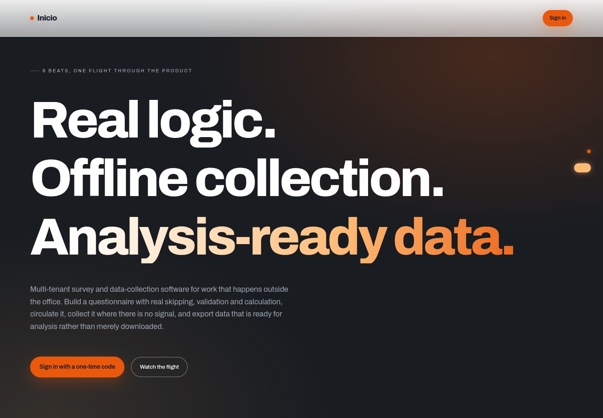

**🌐 The landing page — captured from production**
<br /><sub>Every figure read from the API in that request · the scene is the real WebGL field · 1440×1000</sub>

</td>
</tr>
<tr>
<td valign="top" width="50%" align="center">

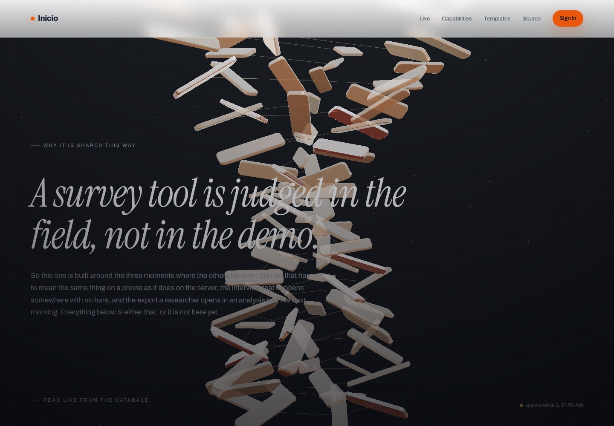

**✨ The light field, scrolled**
<br /><sub>One path and five fills per frame, rearranged as the page is scrolled</sub>

</td>
<td valign="top" width="50%" align="center">

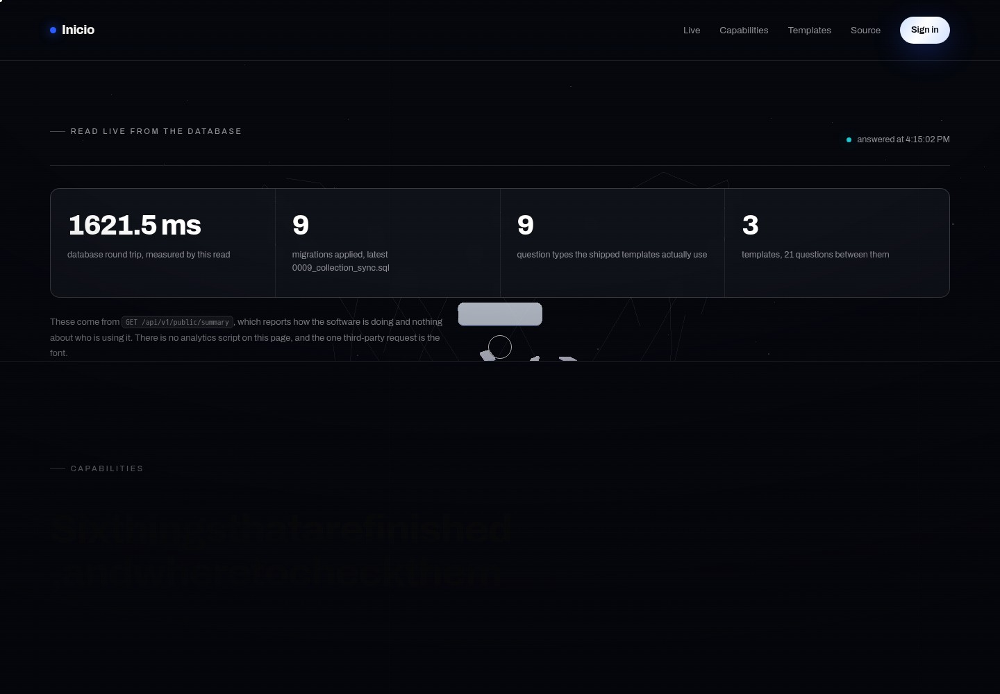

**🧭 Capabilities, claim by claim**
<br /><sub>Each claim ends by naming the two taps that show it working, in the deployment rather than in a file</sub>

</td>
</tr>
<tr>
<td valign="top" width="50%" align="center">

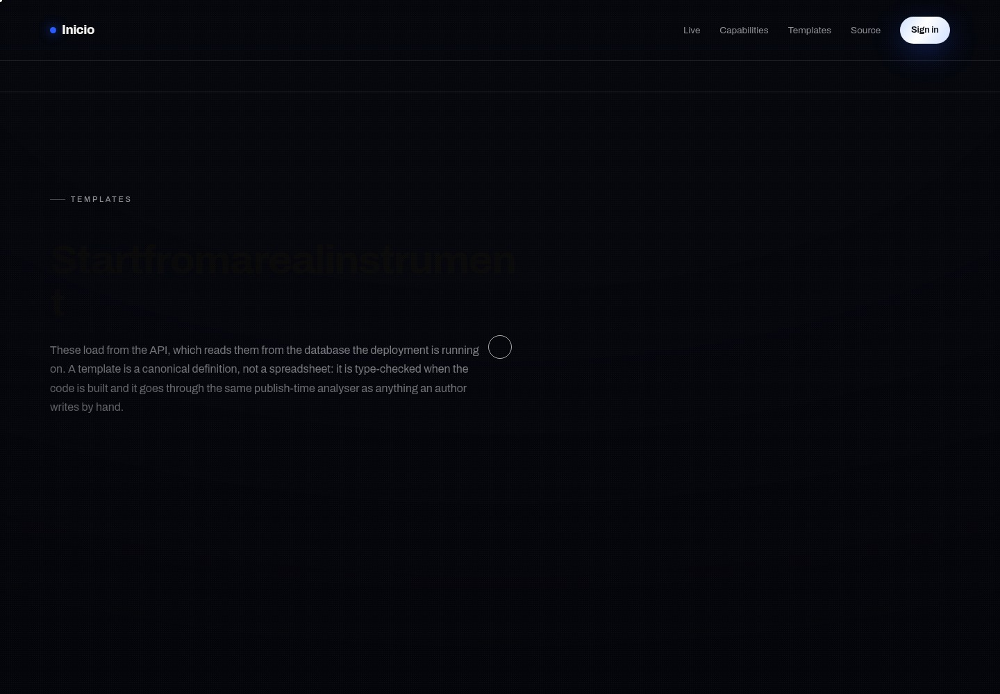

**🏫 The template library**
<br /><sub>Summarised by walking the real definitions, not from a declared list</sub>

</td>
<td valign="top" width="50%" align="center">

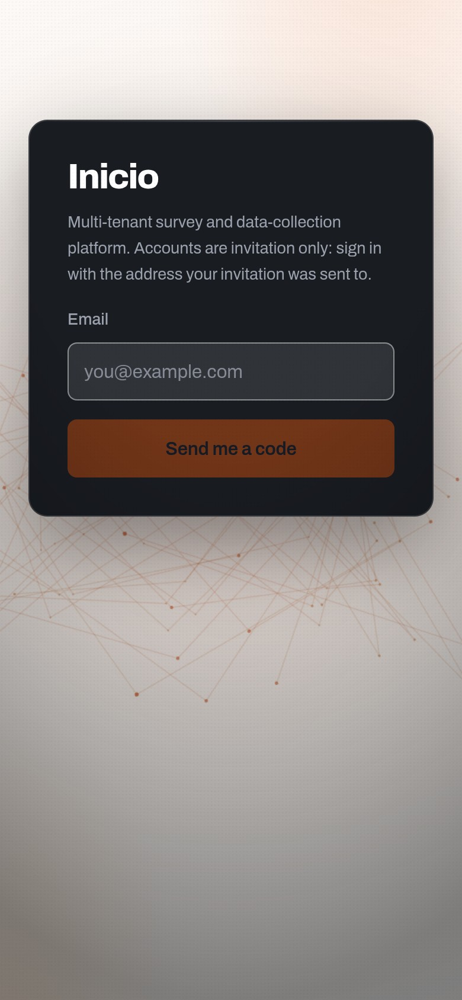

**🔐 Sign-in — phone**
<br /><sub>The same route the landing's button reaches, at 390×844</sub>

</td>
</tr>
<tr>
<td colspan="2" align="center">

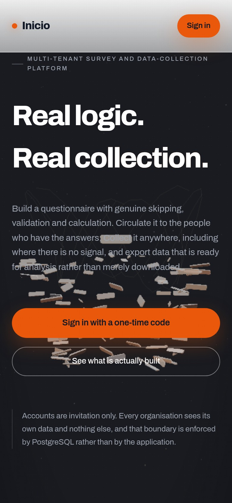

**📱 The landing page — phone**
<br /><sub>A cheaper scene tier under 900 px, and nothing else about the page changes</sub>

</td>
</tr>
</table>

<div align="center"><sub><b>Rendered from the real markup</b> — the signed-in and collection surfaces, drawn as SVG.</sub></div>

<br />

<table>
<tr>
<td valign="top" width="50%" align="center">

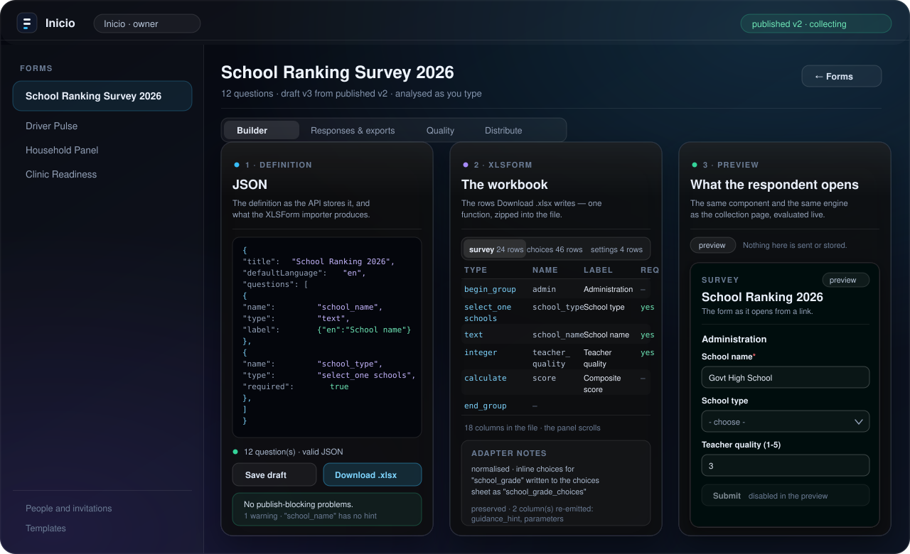

**🖥️ Authoring studio — desktop**
<br /><sub>One definition, three live views: JSON, the workbook, and the form a respondent opens</sub>

</td>
<td valign="top" width="50%" align="center">

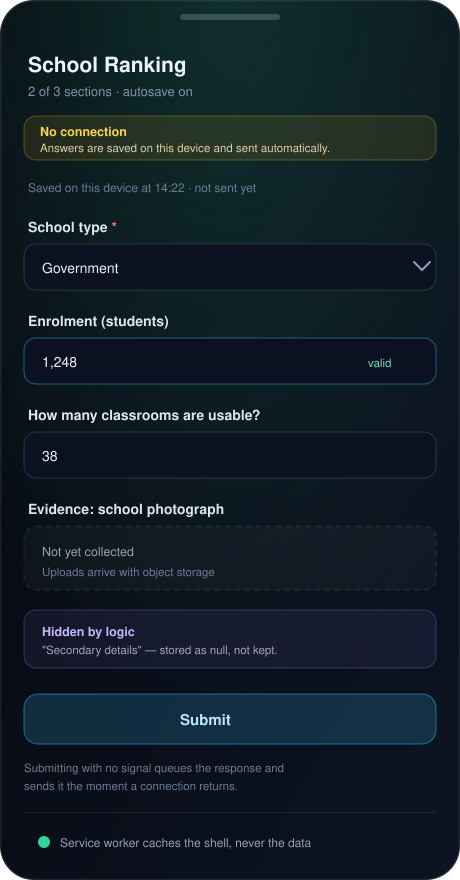

**📱 Collection app — mobile, offline**
<br /><sub>Draft on the device, hidden questions, queued submit, connection state</sub>

</td>
</tr>
<tr>
<td valign="top" width="50%" align="center">

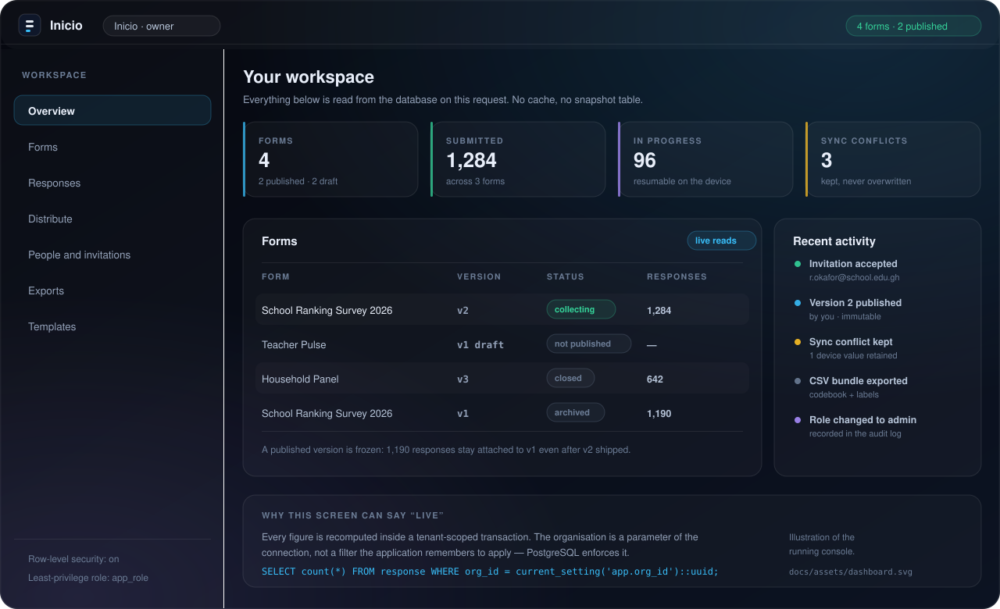

**📊 Workspace overview**
<br /><sub>Live response counts, sync-conflict totals, recent activity</sub>

</td>
<td valign="top" width="50%" align="center">

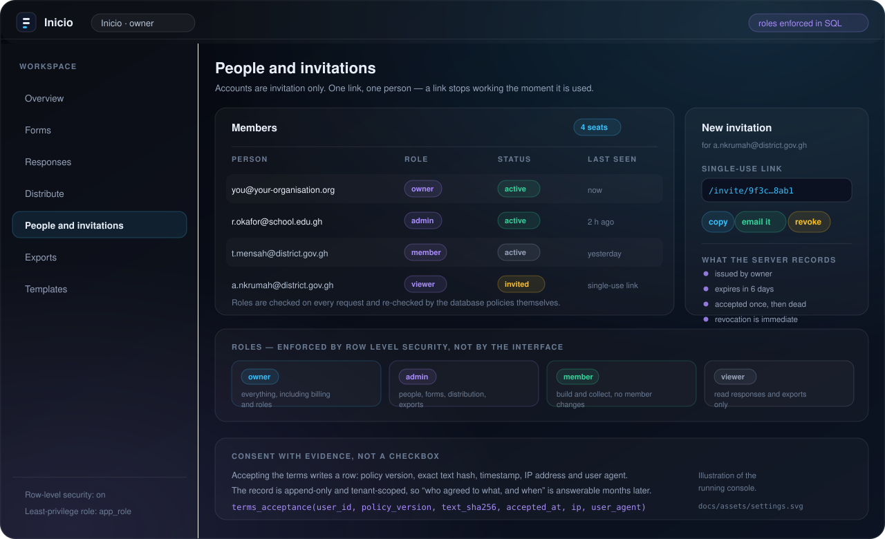

**⚙️ People, roles and invitations**
<br /><sub>Roles enforced in SQL, single-use links, consent evidence</sub>

</td>
</tr>
<tr>
<td valign="top" width="50%" align="center">

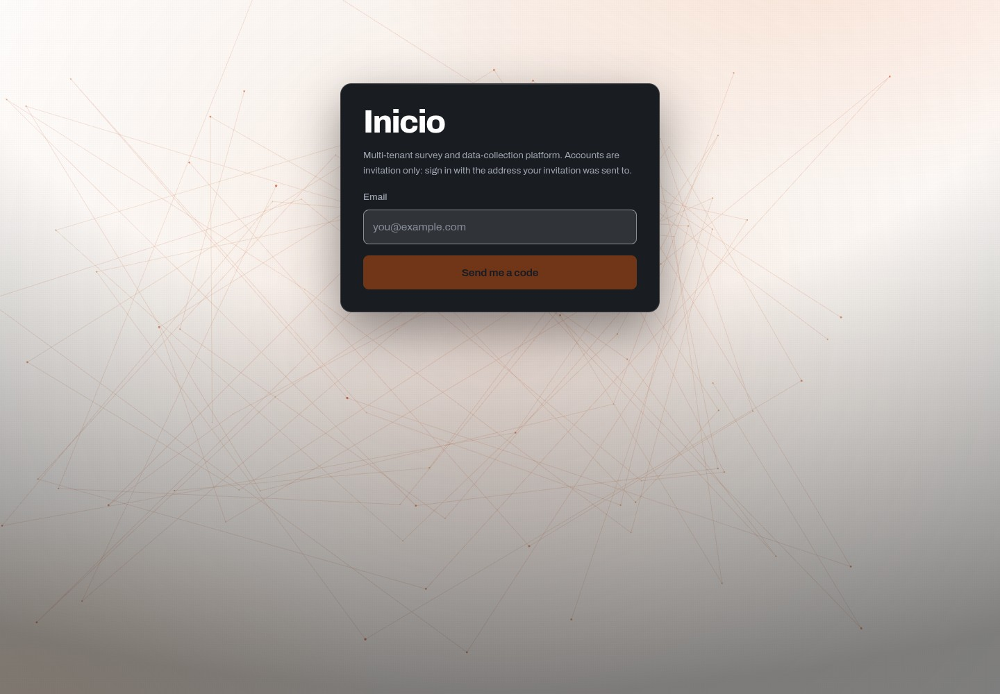

**🔐 Authentication — captured from production**
<br /><sub>One-time codes, invitation gate, no account creation from outside</sub>

</td>
<td valign="top" width="50%" align="center">

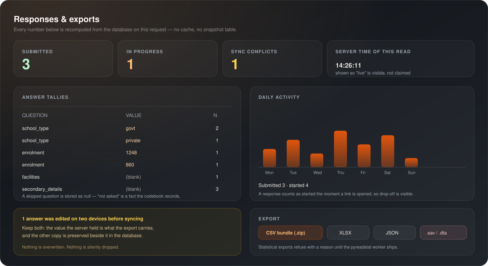

**📈 Analytics and exports**
<br /><sub>Tallies with counts, daily activity, conflict retention, export formats</sub>

</td>
</tr>
</table>

<br />

<div align="center">
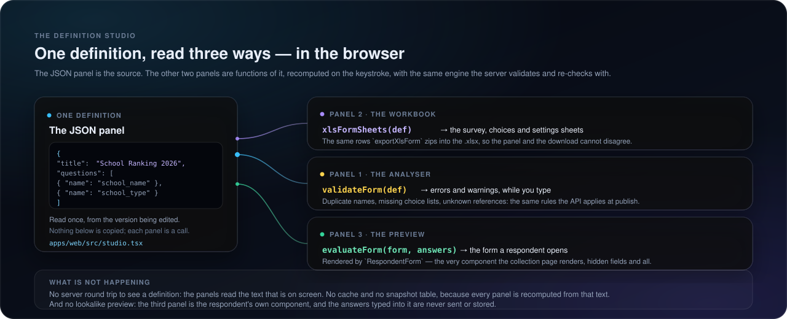
</div>

<div align="center"><sub><b>How the studio is wired.</b> The three panels are not three screens and not three requests: they are one parsed definition read three ways, in the browser, as it is typed. The arrows are function calls from <code>@inicio/engine</code> — the same module the API runs — which is why the preview cannot disagree with the server and the sheet viewer cannot disagree with the file.</sub></div>

<details>
<summary><b>One more screen: XLSForm import</b></summary>

<br />

<div align="center">
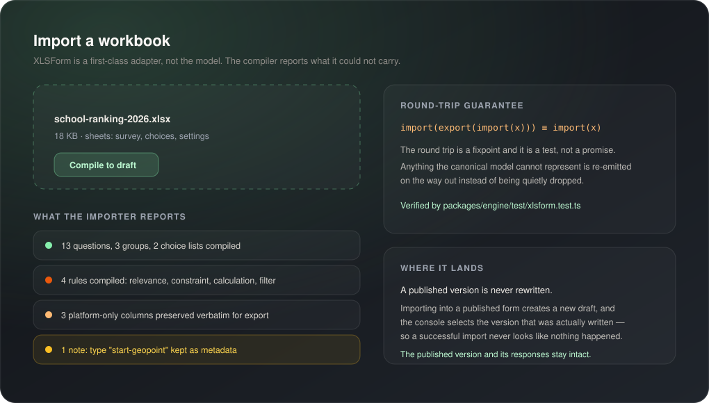
</div>

The importer reports what it could not carry, and importing into a published form creates a new draft
instead of rewriting the version that is already collecting.

</details>

---

## 🎥 Demo

<div align="center">

[](https://inicio-prjct.vercel.app)
[](https://inicio-prjct.vercel.app/health)

</div>

The deployment is invite-only by design, so the tour below is the honest way in: sign-in is a
one-time code, and the first thing the console offers is an invitation.

<table>
<tr>
<td valign="top" width="34%">

**⏱️ 30 seconds — orientation**
<br /><sub>Open the live app, request a code, land in the console.</sub>

<br />

**⏱️ 3 minutes — author**
<br /><sub>Create a form, add a rule, watch the analyser, publish a version.</sub>

<br />

**⏱️ 5 minutes — collect**
<br /><sub>Mint a link, open it on a phone, fill it in, submit.</sub>

<br />

**⏱️ 2 minutes — analyse**
<br /><sub>Watch the tallies move, then export the CSV bundle.</sub>

</td>
<td valign="top" width="66%">

**🎬 A recorded tour is not committed yet.** The two harnesses in `scripts/` are the substitute until
one is: they drive sign-in, authoring, publishing, respondent submissions, conflict handling, exports
and the PWA through a real database, and print a pass/fail line for every check.

```bash
# 35 end-to-end consumer checks + 28 offline-sync checks, against the running stack
pnpm e2e:consumer    # 35 checks: the whole consumer journey
pnpm e2e:offline     # 28 checks: the offline sync contract
```

**Want a video here?** Drop a file into `docs/assets/` and use one of these — the section is already
structured for it:

```markdown
<!-- animated walkthrough -->


<!-- committed video, playable in the GitHub viewer -->
https://github.com/flawsom/Inicio/assets/<asset-id>

<!-- or an embed -->
[](https://www.youtube.com/watch?v=<video-id>)
```

</td>
</tr>
</table>

---


## 🏗 Architecture

One deployable application with four deliberate layers. The API is a single Fastify app whose
feature areas are modules, not microservices — which is why self-hosting it is one process and a
database, not a cluster.

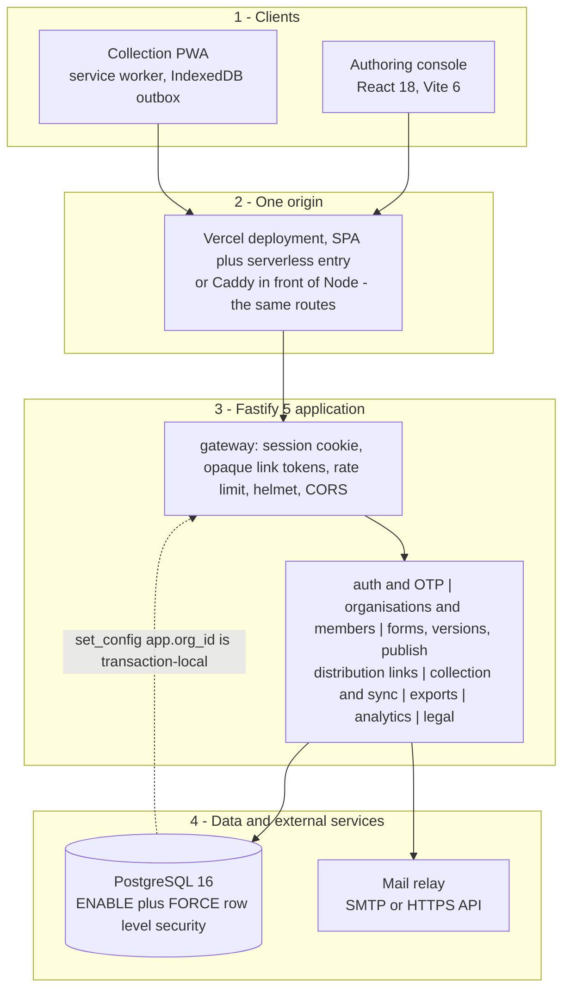

| Layer | What lives there | Where |
|---|---|---|
| **1 · Clients** | The authoring console and the installable collection app. Both call the same `/api/v1` surface; neither holds a secret. | `apps/web` |
| **2 · One origin** | The SPA and the API share a hostname, so the session cookie is host-only and `SameSite=Lax` is enough. | `vercel.json`, `netlify.toml`, `docker/Caddyfile` |
| **3 · Application** | Authentication, organisations and RBAC, authoring and publishing, distribution, collection and sync, exports, analytics, legal. | `apps/api/src/platform` |
| **4 · Data** | PostgreSQL 16 with row-level security per tenant; a mail relay for one-time codes and invitations. | `apps/api/src/db/migrations`, `apps/api/src/mail` |

### How offline collection actually works

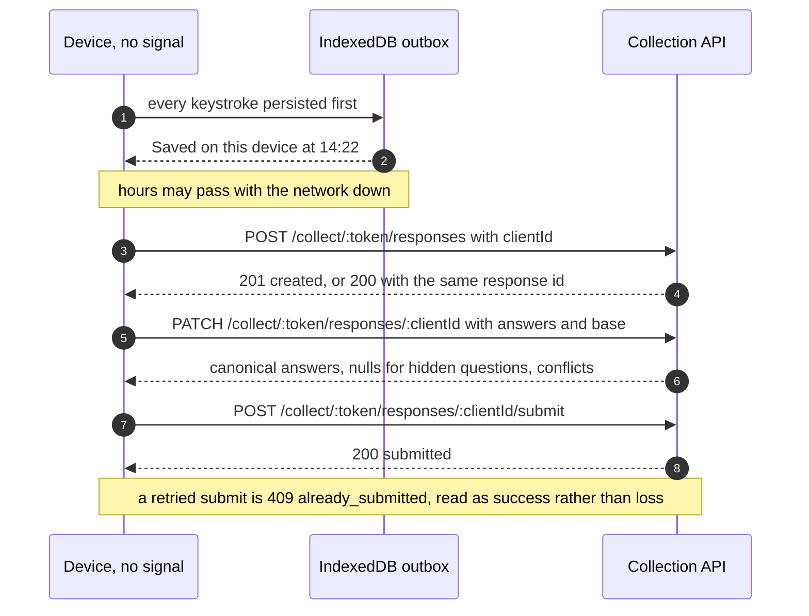

**The merge rules.** A sync carries `base`, the last server state the device saw, so the server can
tell *what the device changed* from *what the server changed*:

| Situation | Outcome |
|---|---|
| Only the device changed a question | The device's value is stored |
| Only the server changed it | The server's value is stored |
| Both changed it to the same thing | They converge |
| **Both changed it differently** | The **server's value** is stored; the device's value is retained in `response_answer.device_value`; the disagreement is recorded in `response_conflict` as `device_server_mismatch` |
| A calculation disagrees with the server's own computation | Stored, and flagged as `calculation_mismatch` |
| A question became irrelevant because logic hid it | Stored as `null` — "not asked" is a fact the codebook keeps |
| A submission fails server-side re-validation (`422`) | Demoted to an ordinary save, and the respondent is told what to fix |

### How multi-tenancy is enforced

```sql
-- 0003_platform.sql — the tenant helper every policy reads
CREATE FUNCTION app_is_member(target uuid) RETURNS boolean LANGUAGE sql STABLE AS $$
  SELECT EXISTS (
    SELECT 1 FROM membership
     WHERE org_id = target
       AND user_id = (SELECT NULLIF(current_setting('app.user_id', true), '')::uuid)
  );
$$;

-- every tenant table, generated per table at migration time
ALTER TABLE form ENABLE ROW LEVEL SECURITY;
ALTER TABLE form FORCE  ROW LEVEL SECURITY;      -- applies to the table owner too
CREATE POLICY form_read ON form FOR SELECT USING (app_is_member(org_id));
```

The application connects as a least-privilege role, and the organisation is a **parameter of the
transaction**, set only after membership has been verified in that same transaction:

```sql
SELECT set_config('app.user_id', $1, true), set_config('app.org_id', $2, true);
```

Three consequences worth stating plainly:

- **Even a forged `app.org_id` returns nothing**, because the policies read `membership` rather than
  trusting the setting. This is tested, not assumed.
- **A bypassing connection stops the process.** On boot the API reads `pg_roles` for `current_user`; a
  superuser or `BYPASSRLS` role is refused in production with a message naming the fix. Managed
  Postgres hands you the owner's connection string by default — that is exactly how this bug happens.
- **`set_config(..., true)` is transaction-local**, so nothing leaks to the next request that checks
  out the same pooled connection.

---

## 🛠 Tech stack

<table>
<tr>
<td valign="top" width="50%">

**🎨 Frontend**
<br />


<br /><sub>No UI framework and no data-fetching library: one `fetch` wrapper, hand-written CSS with custom properties, and a service worker that refuses to cache API responses.</sub>

**⚙️ Backend**
<br />


<br /><sub>TypeScript ESM throughout. WASM hashing rather than a native addon, so the same build runs on any serverless runtime without a compiler.</sub>

</td>
<td valign="top" width="50%">

**🗄️ Database**
<br />


<br /><sub>Ten forward-only SQL migrations. No ORM: typed repository functions, parameterised queries, and RLS underneath all of them.</sub>

**☁️ Cloud & delivery**
<br />


**🔌 APIs & services**
<br />


**🧪 Testing & tooling**
<br />


</td>
</tr>
</table>

<table>
<tr>
<td valign="top" width="50%">

**🤖 AI / ML — deliberately absent**

There is no model in the request path and no data leaves the deployment for training or inference.
The roadmap tracks two additions, both opt-in and both off by default: AI-assisted *authoring* (draft
a definition from a document) and analysis-time helpers. Until they exist and are configured, the
product does not phone anywhere.

<sub>See [`docs/ROADMAP.md`](docs/ROADMAP.md) for the honest list of what is not built.</sub>

</td>
<td valign="top" width="50%">

**💾 Cache, queue and object storage — provisioned, and load-bearing for uploads**

Valkey (cache/queue), MinIO (S3-compatible object storage) and ClamAV (upload scanning) are in the
self-hosted compose profile, and the attachment path is the one that uses them: point
`AWS_ENDPOINT_URL_S3` at MinIO and `CLAMD_HOST` at ClamAV and uploads, limits and the scan run exactly
as they do in production, where the store is a managed one. Nothing in the request path depends on Redis
yet, which is why Valkey stays provisioned rather than required.

<sub>An honest status beats a stack diagram that lies.</sub>

</td>
</tr>
</table>

---

## ⚡ Quick start

### Prerequisites

| | Requirement | Why |
|---|---|---|
|  | **Node.js 22 or newer** | The API and tooling target modern ESM and `node:` builtins |
|  | **pnpm 9.15** (`corepack enable`) | Pinned in `packageManager`; the workspace will not install with npm or yarn |
|  | **Docker** (or any PostgreSQL 16) | The compose profile supplies PostgreSQL, Valkey, MinIO, ClamAV and Mailpit |
|  | **PostgreSQL 16** with `citext` and `pgcrypto` | Migrations create the least-privilege role, the extensions and the policies |

<br />

<table>
<tr>
<td valign="top" width="50%">

### 1 · Install

```bash
git clone https://github.com/flawsom/Inicio.git
cd Inicio

corepack enable
pnpm install --frozen-lockfile
```

</td>
<td valign="top" width="50%">

### 2 · Configure

```bash
cp .env.example .env
# minimum for a local run:
#   DATABASE_URL            the app role's connection
#   MIGRATION_DATABASE_URL  the owner/superuser connection (DDL only)
#   OTP_PEPPER              openssl rand -hex 32
```

Full reference: [environment variables](#-environment-variables).

</td>
</tr>
<tr>
<td valign="top" width="50%">

### 3 · Start the backing services

```bash
docker compose -f docker/docker-compose.yml \
  up -d postgres valkey mailpit
```

Mailpit catches every one-time code locally (its inbox is on
[http://localhost:8025](http://localhost:8025)), so nothing leaves your machine.

</td>
<td valign="top" width="50%">

### 4 · Migrate, and create the first owner

```bash
pnpm db:migrate

# the first account cannot be invited by anybody, so create it deliberately
pnpm --filter @inicio/api bootstrap:owner \
  --email you@example.com --org Inicio
```

`bootstrap:owner` is idempotent: re-running it only ensures the membership exists.

</td>
</tr>
<tr>
<td valign="top" width="50%">

### 5 · Run it

```bash
pnpm dev:api     # Fastify on http://localhost:3001
pnpm dev:web     # Vite on   http://localhost:3000  (proxies /api to the API)
```

Open **http://localhost:3000**, request a one-time code, read it in Mailpit, and you are in.

</td>
<td valign="top" width="50%">

### 6 · Prove it works

```bash
pnpm lint        # ESLint 9, flat config
pnpm typecheck   # tsc across four workspace packages
pnpm test        # 345 tests
pnpm coverage     # v8 coverage, per package
pnpm build       # engine -> api -> web
pnpm budgets     # the built bundle, gzipped, against its ceilings
```

</td>
</tr>
</table>

<details>
<summary><b>No Docker, no root?</b> — the rootless development path</summary>

<br />

`scripts/sandbox-setup.sh` provisions the whole stack in user space: `pnpm` via corepack, and
PostgreSQL 16 from the upstream embedded binary build (chosen because, unlike most embedded wheels,
it ships `contrib`, so `citext` and `pgcrypto` are real and migrations run byte-for-byte as they do
against the `postgres:16` image). It is idempotent, and it is what the verification runs in this
repository use:

```bash
bash scripts/sandbox-setup.sh     # pnpm + postgres on 127.0.0.1:55432 + migrations
```

</details>

<details>
<summary><b>Docker compose: the full local stack</b></summary>

<br />

```bash
docker compose -f docker/docker-compose.yml up -d
docker compose -f docker/docker-compose.yml ps
```

| Service | Image | Port(s) | Role |
|---|---|---|---|
| `postgres` | `postgres:16` | `5432` | Database; `docker/postgres-init` seeds extensions and the app role |
| `valkey` | `valkey/valkey:8-alpine` | `6379` | Cache and queue (provisioned; not in the request path yet) |
| `minio` | `minio/minio` | `9000`, `9001` | S3-compatible object storage; point `AWS_ENDPOINT_URL_S3` at it to collect attachments locally |
| `clamav` | `clamav/clamav:stable` | `3310` | Antivirus for uploads; heavy — start it only when you need it |
| `mailpit` | `axllent/mailpit` | `1025`, `8025` | SMTP catcher and web inbox, so local mail never escapes |

Caddy sits in front as the TLS-terminating reverse proxy in the self-hosted profile
(`docker/Caddyfile`), which is what makes the SPA and the API the same origin outside Vercel too.

</details>

<details>
<summary><b>Environment variables that will bite you</b></summary>

<br />

- **`APP_DATABASE_URL`** wins over `DATABASE_URL` and must name the **least-privilege** role. A
  hosting provider's database integration usually claims `DATABASE_URL` for the owner connection —
  that is precisely the connection that would disable row-level security, so the API refuses to boot
  in production without a non-bypassing role.
- **`OTP_PEPPER`** must be 32+ random bytes and must never change once in use: codes are hashed with
  it, so rotating it invalidates every outstanding code (which is sometimes what you want).
- **`COOKIE_SECURE=true`** and **`APP_ORIGIN=https://your.domain`** in production. The session cookie
  is host-only by design, so splitting the SPA and the API across two hostnames is a configuration
  change, not a flag.

</details>

---

## 📁 Project structure

```
Inicio
├── apps
│   ├── api                          Fastify 5 API — the whole server
│   │   ├── src/platform             platform surface, mounted at /api/v1
│   │   │   ├── auth.ts              OTP sign-in, sessions, invitation redemption
│   │   │   ├── admin.ts             members, roles, invitations, mail diagnostics
│   │   │   ├── orgs.ts              organisations, membership, projects
│   │   │   ├── forms.ts             forms, versions, publish/restore, links, exports
│   │   │   ├── collect.ts           the respondent surface: responses, sync, submit
│   │   │   ├── legal.ts, terms.ts   policy text and consent with evidence
│   │   │   ├── db.ts                withUser / withOrg — the tenant transaction wrapper
│   │   │   ├── events.ts            the push channel: one server-sent event stream per form
│   │   │   ├── public.ts            the one unauthenticated route: live facts, no tenant data
│   │   │   └── guards.ts            authentication and role guards
│   │   ├── src/db/migrations        0001 -> 0010, forward-only SQL
│   │   ├── src/auth, src/legal      the Phase 1 school surface, kept working (/auth/*)
│   │   ├── src/db/pool.ts           role check: refuses a superuser or BYPASSRLS connection
│   │   ├── src/mail                 SMTP and HTTPS relay abstraction
│   │   ├── scripts/bootstrap-owner.ts   the first owner of an organisation
│   │   └── test                     API tests, including the sync-contract suite
│   └── web                          React 18 + Vite 6 client
│       ├── src/App.tsx              the console: forms, builder, responses, quality, admin
│       ├── src/studio.tsx           the three-panel studio, in its own chunk (JSON · XLSForm · preview)
│       ├── src/respondent.tsx       the respondent's form, rendered once for the collection page and the studio
│       ├── src/landing.tsx          the public page: live figures, claims with evidence
│       ├── src/immersive/instrument.ts   the WebGL scene, its own chunk and its own quality tiers
│       ├── src/realtime.ts          EventSource client: coalescing, backoff, the offline verdict
│       ├── src/router.ts            the whole router: six paths and popstate
│       ├── src/collect.tsx          the collection page: definition cache, drafts, outbox (offline-first)
│       ├── src/offline              IndexedDB store, outbox queue, pure sync core
│       ├── public/sw.js             service worker: cache the shell, never the data
│       ├── public/manifest.webmanifest and icons   installable app
│       └── test                     offline core, service worker, realtime, studio, contrast and landing tests
├── packages
│   ├── engine                       canonical form model and everything derived from it
│   │   ├── src/expression.ts        parser and validator for the expression grammar
│   │   ├── src/evaluate.ts          relevance, constraints, calculations, choice filters
│   │   ├── src/adapters/xlsform.ts  XLSForm <-> canonical model (round-trip fixpoint)
│   │   ├── src/adapters/xlsx.ts     workbook reader and writer
│   │   └── src/export               dataset assembly, codebook, value labels, writers
│   └── ui                           reserved: shared components live in apps/web today
├── api/ingest.ts                    Vercel serverless entry point (a translator, not a router)
├── docker/                          compose profile, Caddyfile, postgres init
├── docs/
│   ├── ROADMAP.md                   verified status, what is missing, free-tier ceilings
│   ├── MARKET-RESEARCH.md           why the product is shaped this way
│   └── assets/*.svg                 the illustrations in this README
├── specs/
│   ├── PLATFORM.md                  canonical design (supersedes the school framing)
│   ├── openapi.yaml                 the API contract
│   ├── expression-grammar.md        the grammar the engine implements
│   └── questionnaire.json           the 2026 school ranking survey, as template #1
├── scripts
│   ├── sandbox-setup.sh             rootless local stack (pnpm + embedded PostgreSQL 16)
│   ├── e2e-consumer.mjs             the whole consumer journey over HTTP, against a real database
│   ├── e2e-offline.mjs              the offline sync contract, conflicts included
│   └── netlify-deploy.sh            publish the SPA to Netlify with the API proxied to one origin
├── vercel.json                      one project: SPA and API, one origin
├── netlify.toml                     SPA mirror, /api proxied to the same origin
├── DECISIONS.md                     every significant choice, with the reasoning and the alternatives
└── .env.example                     every variable, documented in place
```

> **Where to look first.** [`specs/PLATFORM.md`](specs/PLATFORM.md) is the design.
> [`DECISIONS.md`](DECISIONS.md) is the *why* — including the bugs found in production and the
> reasoning that closed them. [`docs/ROADMAP.md`](docs/ROADMAP.md) is the honest status, including
> what is deliberately not built.

---

## 🔐 Environment variables

Copy `.env.example` to `.env`. It is the authoritative list — this table is a map of it.

### Runtime

| Variable | Required | Default | Description |
|---|:---:|---|---|
| `NODE_ENV` | yes | `development` | `production` enables the RLS role refusal and strict cookie behaviour |
| `PORT` | | `3001` | API port |
| `APP_ORIGIN` | yes | `http://localhost:3000` | The exact origin the browser uses; drives CORS and cookie policy |

### Database

| Variable | Required | Default | Description |
|---|:---:|---|---|
| `APP_DATABASE_URL` | yes in production | — | **The application's connection — must be the least-privilege role.** Takes precedence over `DATABASE_URL` |
| `DATABASE_URL` | yes | `postgres://app_role:…@localhost:5432/inicio` | Fallback connection when `APP_DATABASE_URL` is unset |
| `MIGRATION_DATABASE_URL` | yes | `postgres://postgres:…@localhost:5432/inicio` | Owner or superuser connection, used **only** for DDL by `pnpm db:migrate` |
| `DATABASE_SSL` | | `false` | `true` for Neon, Tiger Cloud and most managed Postgres |
| `APP_DB_PASSWORD` | | `app_dev_password` | The password migration `0002` gives the `app_role` |

#### Neon: two names for pooling, one axis that matters for privilege

Neon hands out two connections and names them by *pooling*, not by role: `DATABASE_URL` is the direct
endpoint, `DATABASE_URL_POOLED` the pooled one, and both belong to the database's owner. Pooling is not the
axis this platform cares about, so neither name is read as the application's connection. What matters is the
role, and it is set explicitly:

| Connection | Role | Endpoint | Why |
|---|---|---|---|
| `APP_DATABASE_URL` | `app_role` (the least-privilege role from migration `0002`) | pooled | short, frequent serverless invocations |
| `MIGRATION_DATABASE_URL` | owner | direct | DDL does not belong behind a transaction pooler |

An owner connection on Neon typically carries `BYPASSRLS` — this one does — so pointing
`APP_DATABASE_URL` at it would mean no tenant boundary in development and a refusal to boot in production.
`app_role` is created by migration `0002` with `LOGIN` and deliberately **no password**, so one step stays
with the operator, once per database:

```sql
ALTER ROLE app_role WITH LOGIN PASSWORD '<generated>';
```

Put that connection in `APP_DATABASE_URL` and the owner's direct connection in `MIGRATION_DATABASE_URL`.
Both can be verified rather than assumed: `SELECT rolsuper, rolbypassrls FROM pg_roles WHERE rolname =
current_user` for the role, and `pg_stat_activity` for the connection the running API actually holds.

Because the suite reads the same variable names the application does, it owns a **local** database and says
so: `apps/api/test/setup.ts` refuses to run when either host is not this machine, so a workspace wired to a
deployment cannot have a test run create `…_test` on it and drop that schema. See [Testing](#-testing).

### Authentication and sessions

| Variable | Required | Default | Description |
|---|:---:|---|---|
| `OTP_PEPPER` | yes | dev placeholder | 32+ random bytes (`openssl rand -hex 32`); codes are hashed with it, so it must be stable |
| `OTP_TTL_MINUTES` | | `10` | Lifetime of a one-time code |
| `OTP_MAX_ATTEMPTS` | | `3` | Attempts per code before it is dead |
| `OTP_RESEND_COOLDOWN_SECONDS` | | `60` | Minimum interval between code requests |
| `SESSION_COOKIE_NAME` | | `sid` | Session cookie name |
| `SESSION_IDLE_MINUTES` | | `480` | Idle timeout |
| `SESSION_ABSOLUTE_DAYS` | | `30` | Hard expiry, regardless of activity |
| `COOKIE_SECURE` | | `false` | **`true` in production** — requires HTTPS |

### Email

| Variable | Required | Default | Description |
|---|:---:|---|---|
| `SMTP_HOST`, `SMTP_PORT` | yes | `localhost`, `1025` | Relay for codes and invitations (Mailpit locally) |
| `SMTP_SECURE` | | `false` | Implicit TLS, typically `true` with port `465` |
| `SMTP_USER`, `SMTP_PASS` | | — | Credentials when the relay needs them |
| `MAIL_FROM` | | `Inicio Survey <no-reply@…>` | Envelope sender. The live deployment sends as `Inicio <inicio@unifies.codes>`; it must be an address on a domain **verified with the relay**, which is a statement about sending and not about receiving |
| `MAIL_REPLY_TO` | | — | Where a reply to one of these emails lands. **Set it only to a mailbox somebody reads**: the welcome invites a reply when it is set and offers an owner or an admin instead when it is not, because an instruction that bounces is worse than no instruction |
| `MAIL_TRANSPORT` | | inferred | `smtp` or `resend`; inferred from `RESEND_API_KEY` when unset |
| `RESEND_API_KEY` | | — | Choose the HTTPS API when the network refuses SMTP ports (25/465/587) |
| `S3_BUCKET` | for file uploads | — | Where attachments live. With no bucket the upload control is not offered at all, and an `image`/`audio`/`video`/`file` question stays unanswered and says so |
| `S3_ENDPOINT` | | — | For object storage that is not AWS and is reached by a bare endpoint |
| `S3_REGION` | | — | The region to sign for, when `AWS_REGION` is not the one in use |
| `AWS_ACCESS_KEY_ID` | for file uploads | — | The signer: used for the presigned `PUT` and for the API's own `HEAD`, `GET` and `DELETE` |
| `AWS_SECRET_ACCESS_KEY` | for file uploads | — | The signer's secret; it never leaves the server |
| `AWS_REGION` | | — | The region bound into the signature |
| `AWS_ENDPOINT_URL_S3` | | — | The standard AWS name for a custom endpoint, if that is how the host names it |
| `UPLOAD_MAX_BYTES` | | `10485760` | The ceiling for one attachment — checked when the upload is authorised, and again against the size the store itself reports |
| `CLAMD_HOST` | | — | The scanner the upload's scan step talks to. **With no host, a file is recorded `skipped`, which is not the same as `clean`.** `CLAMD_PORT` (3310) and `CLAMD_TIMEOUT_MS` (15000) have defaults |
| `ATTACHMENT_SCAN_POLICY` | | `allow_unscanned` | Whether an unscanned file may become an answer. `allow_unscanned` accepts a file whose scan was `skipped` **or** `error` — a field team whose scanner host is unreachable must not lose every upload — while the row keeps the two apart; `require` makes a scanner's verdict mandatory and refuses at authorisation with `scan_required`, before any URL is signed. The policy is reported to the client, so the page states it rather than assuming it |
| `PYREADSTAT_WORKER_URL` | | — | The `.sav`/`.dta` worker (`services/pyreadstat`). With no URL those two exports refuse with a `501` that names this variable. `PYREADSTAT_TIMEOUT_MS` (20000) has a default |
| `RESEND_API_URL` | | `https://api.resend.com/emails` | Override for a compatible endpoint |

A relay will not send from a domain the account does not own, and the failure is worth
knowing in advance because it arrives as a refusal rather than a bounce. With Resend,
`MAIL_FROM` must be an address on a **verified** domain in that account: an unverified one is
rejected outright (`This API key is not authorized to send emails from …`), and the shared
`onboarding@resend.dev` sender is accepted but only reaches the account's own address. Neither
is a guess — both are what the provider answered when asked. `GET /api/v1/auth/mail-status` (and the
sign-in screen, which is built on it) reports the same evidence rather than an assumption:
a probe, a message the relay actually accepted, or nothing yet. On a serverless deployment that last
one resets with every cold start, so `basis: none` there means "nothing has been sent by this
instance", which is a different thing from a relay that refused.

**A verified domain is verified for sending, which is not the same as having an inbox.** The four
emails this product writes — the sign-in code, the welcome, the sign-in notice and the submission
receipt — are `apps/api/src/mail/templates.ts`, and the identity they leave under is `MAIL_FROM`.
A sender does not need a mailbox; a reply target does, and the two are separate variables for that
reason. The delivery path itself was verified against the live relay rather than assumed: all four
went out through Resend from `inicio@unifies.codes` and arrived in a mailbox with their links, both
alternatives and their palette intact (`26/26` content checks, `4/4` reported `delivered`).

### Attachments and object storage

S3-compatible, and optional on purpose. **With no bucket configured the API answers `501
storage_not_configured` and the renderer goes on saying those questions are not collected here** — a
supported state for a deployment that has nowhere to put a file, not a broken one.

| Variable | Required | Default | Description |
|---|:---:|---|---|
| `S3_BUCKET` | for uploads | — | Bucket that holds answer attachments |
| `AWS_ENDPOINT_URL_S3` | for uploads | — | Path-style S3-compatible endpoint; `S3_ENDPOINT` overrides it |
| `AWS_ACCESS_KEY_ID`, `AWS_SECRET_ACCESS_KEY` | for uploads | — | Used to **sign** a URL and nothing else; they never reach a browser |
| `AWS_REGION` | | `us-east-1` | Signing region; `S3_REGION` overrides it |
| `UPLOAD_MAX_BYTES` | | `10485760` | Ceiling for one attachment, checked when the upload is authorised and again against the size the store reports |
| `CLAMD_HOST` | | — | Scanner for uploaded bytes. Unset means nothing is scanned and every file records `skipped` |
| `CLAMD_PORT`, `CLAMD_TIMEOUT_MS` | | `3310`, `15000` | clamd INSTREAM port, and how long its verdict is awaited |

The allowlist of file types is per question type and lives in the API
(`apps/api/src/storage/limits.ts`), not in the browser. What `scan_status` says is what happened:
`clean` means a scanner read the bytes, `infected` means it named something and the object was deleted,
`error` means a configured scanner did not answer, and `skipped` means there is no scanner here at all.

### Cache, bootstrap and access control

| Variable | Required | Default | Description |
|---|:---:|---|---|
| `REDIS_URL` | | `redis://localhost:6379` | Valkey; the product runs without it today |
| `ADMIN_EMAIL`, `ADMIN_PASSWORD` | for `admin:create` | — | Used once by the Phase 1 admin bootstrap; the password must be at least 12 characters |
| `INVITE_ONLY` | | `true` | `false` opens self-registration. **Leave it `true`** unless you intend an open deployment |

<sub>⚠️ **Never commit a real `.env`.** `.gitignore` covers `.env`, `.env.*` and `!.env.example` — and
the API logs no secret material, including one-time codes.</sub>

---


## 📖 API

### Base URL

```
https://inicio-prjct.vercel.app/api/v1     # the live deployment
http://localhost:3001/api/v1               # local API
http://localhost:3000/api/v1               # through the Vite proxy — the same origin the browser uses
```

The contract lives in [`specs/openapi.yaml`](specs/openapi.yaml), and it is **held to the code**:
`apps/api/test/openapi.test.ts` parses it, reads the route registrations out of the source, and fails
the suite for a route with no entry *and* for an entry whose route is gone.

### Authentication

| Surface | Credential | Notes |
|---|---|---|
| Console (authoring, admin, exports) | `sid` session cookie | Obtained from a one-time code. `httpOnly`, `Secure`, `SameSite=Lax`, host-only — which is why the SPA and the API share an origin. |
| Collection (respondents) | Opaque token in the path | `POST /collect/:token/responses`. The token is 32 CSPRNG bytes returned **once** and stored only as a hash. No account, no cookie. |
| Machine clients (an export job, a QC pipeline, a house dashboard) | `Authorization: Bearer ik_…` | An API key is a **restricted session for its creator**: it acts only inside the organisation it was issued for, only at a route that declares one of its scopes, and it stops working the moment that person leaves the team. The secret is 32 random bytes, returned once by the create call and stored only as `sha256(secret)`. |

**Status vocabulary** — errors are machine-readable and stable, not prose:

| Code | Errors |
|---|---|
| `400` | `invalid_request`, `unknown_format`, `acceptance_required` |
| `401` | `unauthenticated`, `invalid_api_key` (unknown, expired or revoked), `invalid_otp` (`expired`, `mismatch`, `attempts_exceeded`) |
| `403` | `forbidden`, `read_only_role`, `terms_required`, `key_not_permitted` (this route is session-only), `insufficient_scope` (naming the scope the key lacks), `key_org_mismatch` (a key pointed at another organisation) |
| `404` | `not_found`, `link_not_found`, `unknown_template` — **a non-member gets `404`, not `403`**, because whether an organisation exists is not a member's business to probe |
| `409` | `already_submitted`, `client_id_conflict`, `not_published`, `version_immutable`, `version_archived`, `last_owner` |
| `410` | `link_expired`, `link_already_used`, `link_exhausted`, `link_inactive` |
| `422` | `invalid_definition` — publication is where authoring errors become a blocked publish instead of a broken form mid-interview |
| `501` | Export formats that are deliberately not implemented yet (`.sav`, `.dta`), returned **with a reason** |

**Machine access is deny-by-default, and that is the design.** A key reaches a route only when that route *declares* the capability it needs, so the machine surface is a list you can read rather than the absence of a check you cannot see. The scopes, and what each one buys:

| Scope | Routes it opens |
|---|---|
| `forms:read` | `GET /forms`, `GET /forms/:formId`, `GET /forms/:formId/versions/:versionId`, `GET /forms/:formId/xlsform` |
| `responses:read` | `GET /forms/:formId/responses` |
| `analytics:read` | `GET /forms/:formId/analytics` |
| `responses:export` | `GET /forms/:formId/responses/export` |
| `flags:read` | `GET /orgs/:orgId/flags` |
| `flags:write` | `PATCH /orgs/:orgId/flags/:flagId`, `POST …/flags/scan`, `POST …/responses/:responseId/flags` |

`GET /api-scopes` marks each scope with whether a route declares it today, and the console will not offer one that no route declares — because a key granted only vocabulary is a key that can call nothing. Three consequences worth stating, because each one is a property of the route table rather than a promise: a key can never mint or revoke another key; it can never publish a form or move a distribution link; and it can never change where an organisation's data is sent. It also only ever reads its own organisation — a key for A is `403 key_org_mismatch` against B's form even when its creator is a member of both, and `GET /forms` is narrowed to that organisation in SQL rather than filtered afterwards.

### Endpoints

<details open>
<summary><b>Authentication, invitations and consent</b></summary>

<br />

| Method | Path | Auth | Purpose |
|---|---|---|---|
| `POST` | `/auth/otp/request` | — | Request a one-time code. Always answers `{ "status": "sent" }`; an unknown address is a `404` and never a special case |
| `POST` | `/auth/otp/verify` | — | Exchange a code for a session cookie |
| `GET` | `/auth/me` | cookie | Identity plus the organisations the caller can see |
| `GET` | `/auth/session` | cookie | The subject behind the current session |
| `POST` | `/auth/logout` | cookie | Revoke the session (`204`) |
| `GET` | `/invite/:token` | — | Look at an invitation **without spending it** |
| `POST` | `/invite/redeem` | — | Spend it: creates the membership the invitation names |
| `GET` | `/legal/terms`, `/legal/privacy` | — | The exact text, with its version and hash |
| `GET` | `/auth/terms/status` | cookie | Whether this account has accepted the current text |
| `POST` | `/auth/terms/accept` | cookie | Record acceptance with evidence |
| `GET` | `/mail-status` | — | Whether a relay is configured, without leaking how |

</details>

<details>
<summary><b>Organisations, members and invitations</b></summary>

<br />

| Method | Path | Auth | Purpose |
|---|---|---|---|
| `GET` / `POST` | `/orgs` | cookie | List organisations, or create one (the creator becomes **owner**) |
| `GET` / `PATCH` | `/orgs/:orgId` | cookie + role | Read or update an organisation |
| `GET` / `POST` | `/orgs/:orgId/members` | cookie + role | List members, or add one |
| `PATCH` / `DELETE` | `/orgs/:orgId/members/:userId` | owner/admin | Change a role or remove a member (`409 last_owner` protects the last owner) |
| `GET` / `POST` | `/orgs/:orgId/invites` | admin | List or issue single-use invitations |
| `DELETE` | `/orgs/:orgId/invites/:inviteId` | admin | Revoke an invitation (immediately) |
| `GET` / `POST` | `/orgs/:orgId/projects` | cookie + role | Projects: the seam a workspace layer will grow into |
| `GET` | `/orgs/:orgId/diagnostics/mail` | owner | Why mail is, or is not, flowing |

</details>

<details>
<summary><b>Forms, versions and publishing</b></summary>

<br />

| Method | Path | Auth | Purpose |
|---|---|---|---|
| `GET` / `POST` | `/forms` | cookie + role · key `forms:read` (GET only, own organisation only) | List forms (with published version and response state), or create one |
| `GET` / `PATCH` | `/forms/:formId` | cookie + role · key `forms:read` (GET only) | Read a form with its versions, or update it |
| `POST` | `/forms/:formId/versions` | member+ | Create a new draft version |
| `GET` / `PUT` | `/forms/:formId/versions/:versionId` | member+ · key `forms:read` (GET only) | Read or replace a **draft** definition |
| `POST` | `/forms/:formId/versions/:versionId/publish` | admin+ | Publish — validated first, then frozen |
| `POST` | `/forms/:formId/versions/:versionId/restore` | admin+ | Fork an old version into a **new** draft |
| `POST` | `/forms/:formId/import` | member+ | Compile an XLSForm workbook and report what it could not carry |
| `GET` | `/forms/:formId/xlsform` | member+ · key `forms:read` | Export the form back to XLSForm |
| `GET` | `/templates` | cookie | Template library (the school ranking survey is #1) |

</details>

<details>
<summary><b>Distribution, collection, responses and analytics</b></summary>

<br />

| Method | Path | Auth | Purpose |
|---|---|---|---|
| `GET` / `POST` | `/forms/:formId/links` | admin+ | List or mint distribution links (`anonymous`, `single_use`, `multiple`, `panel`) |
| `DELETE` | `/forms/:formId/links/:linkId` | admin+ | Revoke a link |
| `GET` | `/collect/:token` | token | The published definition a respondent sees, cached for offline use |
| `POST` | `/collect/:token/responses` | token | **Start or resume by device UUID.** `201` when created, `200` with the same id when retried |
| `GET` / `PATCH` | `/collect/:token/responses/:responseId` | token | Read or sync answers (`{ answers, base }`) |
| `POST` | `/collect/:token/responses/:responseId/submit` | token | Submit; a retry answers `409 already_submitted` |
| `GET` | `/forms/:formId/responses` | cookie + role · key `responses:read` | Response list with per-response conflict counts |
| `GET` | `/forms/:formId/analytics` | cookie + role · key `analytics:read` | Live tallies, status counts, conflicts, daily activity |
| `GET` | `/forms/:formId/events` | cookie + role | The push channel: a server-sent event stream naming the aggregates that changed, coalesced per tick. Session-only, because `EventSource` cannot send an `Authorization` header |
| `GET` | `/forms/:formId/responses/export?format=csv\|xlsx\|json` | cookie + role · key `responses:export` | Exports; `csv` returns a zip bundle with data, codebook, value labels and missing codes |

</details>

<details>
<summary><b>Integrations: API keys, webhooks and the quality queue</b></summary>

<br />

| Method | Path | Credential | Scope | Purpose |
|---|---|---|---|---|
| `GET` | `/api-scopes` | cookie | — | The scope vocabulary, with a flag on each saying whether a route declares it today |
| `GET` / `POST` | `/orgs/:orgId/api-keys` | cookie | — | List keys (**never** a secret), or mint one: the secret is in the create response and nowhere else, because only its hash exists |
| `DELETE` | `/orgs/:orgId/api-keys/:keyId` | cookie | — | Revoke. The next request with it answers `401 invalid_api_key`; the second revoke answers `404` |
| `GET` | `/webhook-events` | cookie | — | The event catalogue and what each event means |
| `GET` / `POST` | `/orgs/:orgId/webhooks` | cookie | — | List endpoints with their pending and failed counts, or create one — **HTTPS only**, enforced by a database constraint, with a signing secret returned once |
| `PATCH` / `DELETE` | `/orgs/:orgId/webhooks/:endpointId` | cookie | — | Change, pause, re-enable or delete an endpoint (and its history) |
| `GET` | `/orgs/:orgId/webhooks/:endpointId/deliveries` | cookie | — | Delivery history: status, attempts, the receiver's status, the error |
| `POST` | `/orgs/:orgId/webhooks/:endpointId/test` | cookie | — | Sign and send a synthetic event **now** and report the receiver's real answer, including its failure status |
| `POST` | `/orgs/:orgId/webhooks/deliveries/:deliveryId/retry` | cookie | — | Requeue one delivery and drain, so "did it work this time" is the reply |
| `GET` | `/flag-kinds` | cookie or key | — | The flag vocabulary and the thresholds, in words |
| `GET` | `/orgs/:orgId/flags` | cookie or key | `flags:read` | The queue (`status`, `formId`, `limit`) with counts by status and by kind |
| `PATCH` | `/orgs/:orgId/flags/:flagId` | cookie or key | `flags:write` | Resolve or dismiss, with the note that records **why** |
| `POST` | `/orgs/:orgId/forms/:formId/flags/scan` | cookie or key | `flags:write` | Detect exact duplicate submissions. Idempotent: a finding is recorded once, however often you scan |
| `POST` | `/orgs/:orgId/forms/:formId/responses/:responseId/flags` | cookie or key | `flags:write` | Raise a flag by hand, with a severity and a note |

A webhook delivery carries `X-Inicio-Timestamp` and `X-Inicio-Signature: sha256=<HMAC-SHA256 of "${timestamp}.${body}">`, signed with the endpoint's own secret — the construction Stripe and GitHub use, and for the same reason: the timestamp is inside the signed material, so a captured request cannot be replayed later. Verify it against the raw body, before parsing. Deliveries are enqueued **in the same transaction as the event they describe**, which is what makes an event exactly-once with the data: a publish that committed has delivery rows and a publish that rolled back has none. Delivery itself is at-least-once against a stable delivery id, and after five consecutive failures an endpoint disables itself and says why, because an endpoint that has failed two dozen times is usually a deleted receiver.

</details>

<details>
<summary><b>The public surface</b></summary>

<br />

| Method | Path | Auth | Purpose |
|---|---|---|---|
| `GET` | `/public/summary` | — | The one unauthenticated route. Server version and uptime, the measured round trip of the query that produced the response, the migration ledger, and the template library summarised by walking the real definitions. No form, response, organisation or count of any of them. Never stored |

</details>

### Example: the console journey

```bash
API=https://inicio-prjct.vercel.app/api/v1

# 1 - a one-time code (read it in Mailpit locally, or in your inbox in production)
curl -sS -X POST "$API/auth/otp/request" \
  -H 'content-type: application/json' \
  -d '{"email":"you@example.com"}'
# -> 200 {"status":"sent"}

# 2 - exchange it for a session cookie
curl -sS -c cookies.txt -X POST "$API/auth/otp/verify" \
  -H 'content-type: application/json' \
  -d '{"email":"you@example.com","code":"123456"}'
# -> 200 {"subject":"user:..."}   and Set-Cookie: sid=...

# 3 - accept the terms (required before the workspace opens)
curl -sS -b cookies.txt -X POST "$API/auth/terms/accept" \
  -H 'content-type: application/json' \
  -d '{"termsVersion":"2026-01","privacyVersion":"2026-01","accepted":true}'
# -> 200 {"accepted":true,"termsVersion":"2026-01"}

# 4 - create an organisation (the creator is its owner)
curl -sS -b cookies.txt -X POST "$API/orgs" \
  -H 'content-type: application/json' -d '{"name":"Inicio"}'
# -> 201 {"organisation":{"id":"...","name":"Inicio","slug":"inicio"}}

# 5 - create a form from a schema
curl -sS -b cookies.txt -X POST "$API/forms" \
  -H 'content-type: application/json' \
  -d '{"orgId":"<org-uuid>","name":"Household panel","definition":{ ... }}'
# -> 201 {"form":{"id":"..."}}

# 6 - publish a version, then mint a distribution link
curl -sS -b cookies.txt -X POST "$API/forms/<form-uuid>/versions/<version-uuid>/publish"
# -> 200 {"version":{...},"report":{"errors":[],"warnings":[...]},"alreadyPublished":false}

curl -sS -b cookies.txt -X POST "$API/forms/<form-uuid>/links" \
  -H 'content-type: application/json' -d '{"kind":"anonymous"}'
# -> 201 {"link":{...},"token":"...","collectPath":"/api/v1/collect/..."}
```

### Example: a device that was offline

This is the exact sequence the collection app performs, and the sequence the offline harness asserts.

```bash
TOKEN=<the-token-from-the-link>
CLIENT=$(uuidgen | tr 'A-Z' 'a-z')      # the device invents the response id

# start: the same call twice is the same response, never two
curl -sS -X POST "$API/collect/$TOKEN/responses" \
  -H 'content-type: application/json' -d "{\"clientId\":\"$CLIENT\"}"
# -> 201 {"responseId":"$CLIENT","created":true}
# -> 200 {"responseId":"$CLIENT","created":false}   <- the retry

# sync: `base` is the last server state this device saw
curl -sS -X PATCH "$API/collect/$TOKEN/responses/$CLIENT" \
  -H 'content-type: application/json' \
  -d '{"answers":{"score":20},"base":{"score":3}}'
# -> 200 {"saved":1,"answers":{"score":20},"conflicts":0,"missing":[],"invalid":[]}

# submit: and if the connection dies, submit again - that is not an error
curl -sS -X POST "$API/collect/$TOKEN/responses/$CLIENT/submit" \
  -H 'content-type: application/json' -d '{"answers":{"score":20},"base":{}}'
# -> 200 {"responseId":"...","status":"submitted","answered":1,"conflicts":0}
# -> 409 {"error":"already_submitted"}      <- read as success, never as loss
```

**A conflict, observed rather than described.** Two devices edit the same field from the same base:

```jsonc
// PATCH #1 - device A moves score 3 -> 20, from base { "score": 3 }
{ "answers": { "score": 20 }, "base": { "score": 3 } }
// -> 200 { "answers": { "score": 20 }, "conflicts": 0 }

// PATCH #2 - device B moves the same field 3 -> 9, from the *same* base
{ "answers": { "score": 9 }, "base": { "score": 3 } }
// -> 200 {
//      "answers":   { "score": 20 },   // the server's value is what the export carries
//      "conflicts": 1                  // and the disagreement is a row, not a log line
//    }
```

```sql
SELECT value, device_value FROM response_answer WHERE response_id = '...';  -- 20 | 9
SELECT kind               FROM response_conflict WHERE response_id = '...';  -- device_server_mismatch
```

---

## 🎯 Usage examples

<table>
<tr>
<td valign="top" width="50%">

**A definition is ordinary JSON**

```json
{
  "title": "School Ranking Survey 2026",
  "defaultLanguage": "en",
  "languages": ["en"],
  "questions": [
    {
      "id": "q_enrolment",
      "name": "enrolment",
      "type": "integer",
      "label": { "en": "Enrolment (students)" },
      "validation": { "constraint": ". >= 0" }
    },
    {
      "id": "q_secondary",
      "name": "secondary_details",
      "type": "text",
      "label": { "en": "Secondary details" },
      "rules": { "visibleIf": "${level} = 'secondary'" }
    }
  ],
  "choiceLists": {}
}
```

The same object is what the analyser validates, what the engine evaluates in the browser, what
XLSForm imports and exports, and what the export pipeline reads to build a codebook.

</td>
<td valign="top" width="50%">

**Expressions the engine actually supports**

```
${level} = 'secondary'                        relevance
. >= 0 and . <= 10                            constraint on the current answer
${enrolment} * 2 + 12                         calculation
selected(${facilities}, 'library')            choice filters and selections
not(${attended}) or ${sessions} > 0           boolean composition
```

```ts
import { parseExpression, evaluate } from '@inicio/engine';

const expression = parseExpression('${enrolment} > 0');
const relevant = evaluate(expression, { enrolment: 1248 }); // true
```

Expressions are parsed and validated at **publish** time, so a typo is a blocked publish with a
question name in it — never a blank field in front of a respondent.

</td>
</tr>
<tr>
<td valign="top" width="50%">

**The offline queue, one deep and durable**

```ts
// every keystroke goes to IndexedDB *before* anything is sent
await store.saveDraft(linkToken, { answers: next, base });

// a save supersedes the previous save; a submit supersedes a pending save
await outbox.enqueue({ kind: 'submit', answers: next, base });

// the core is pure — this is why it is unit-testable
const plan = planSync({ local: answers, base, server: canonical });
// -> { entries, values, missing, invalid, conflicts }
```

A long outage therefore cannot build a backlog of stale payloads: the queue holds the **latest**
intent, not a history of intentions.

</td>
<td valign="top" width="50%">

**Exports are pipelines, not dumps**

```bash
# data + codebook + value labels + missing codes, zipped
curl -sS -b cookies.txt \
  "$API/forms/<uuid>/responses/export?format=csv" -o export.zip

curl -sS -b cookies.txt \
  "$API/forms/<uuid>/responses/export?format=json" | jq '.data[0]'
```

```jsonc
{
  "data": [ { "response_id": "...", "score": 20, "secondary_details": null } ],
  "codebook": [ { "name": "score", "type": "integer", "label": "Score" } ],
  "valueLabels": [ { "name": "level", "value": "secondary", "label": "Secondary" } ]
}
```

A skipped question is exported as `null`, and the codebook records that it was **not asked** rather
than leaving its absence ambiguous.

</td>
</tr>
</table>

---

## 📊 Performance

### Measured on the live deployment

Method: 12 sequential requests per path from a single VM over the public internet, 0.6 s apart,
`time_starttransfer` in milliseconds, 13 October 2026, against the deployment this work produced.
Reproduce it:

```bash
for i in $(seq 1 12); do
  curl -sS -o /dev/null -w "%{time_starttransfer}\n" https://inicio-prjct.vercel.app/
  sleep 0.6
done
```

| Path | What it measures | Median | p95 | Notes |
|---|---|---:|---:|---|
| `/` (HTML shell) | Edge cache and static shell | **91 ms** | 110 ms | max 160 ms |
| `/assets/index-*.js` | The whole app: 222.88 kB, **70.87 kB over the wire**¹ | **93 ms** | 113 ms | max 162 ms |
| `/assets/landing-*.js` | The landing page, after first paint: 16.20 kB, **5.56 kB over the wire** | **92 ms** | 102 ms | max 105 ms |
| `/assets/instrument-*.js` | three.js, the landing page only: 533.48 kB, **135.76 kB over the wire** | **92 ms** | 100 ms | max 100 ms |
| `/api/v1/legal/terms` | Function, **no database round trip** | **92 ms** | 99 ms | max 171 ms |
| `/api/v1/public/summary` | Function **with** a database round trip, never cached | **395 ms** | 471 ms | one cold start at 1 780 ms in this sample |
| `/health` | Function **with** a database round trip | **393 ms** | 412 ms | max 420 ms |

<sub>¹ The three asset rows measure the build that was deployed, which predates the integration and
quality screens; the current tree compiles to 239.9 kB of app and 75.1 kB over the wire (see
[Bundle size](#bundle-size)), and the *latency* is a property of the host and the request, not of a
particular hash.</sub>

**The honest reading of that table:** the gap is not between static assets — 222.88 kB of app and
533.48 kB of three.js cross the wire in the same ~92 ms, because they are served from the edge and the
network is not the constraint. It is between the static rows and the last two, and it is geography
rather than code: the serverless function's round trip to PostgreSQL, which is 300 ms of the 395. That
is also the number that matters most for feel: the ambient field and every entrance animation run on the
device, but nothing that reads the database can appear before its round trip, so the function region and
the database region being co-located is the single largest perceived-speed win available here, and it is
a hosting setting rather than a code change.

<sub>⚠️ A sustained burst from one address eventually trips the hosting provider's own bot mitigation
(I measured this the hard way). Browsers pass that checkpoint transparently; scripted benchmarks
should expect a `403` and back off.</sub>

### Bundle size

Generated by `pnpm build` — the entire frontend, with no framework runtime beyond React:

The console and the landing page are separate chunks, and that separation is the point: three.js is
only ever fetched by a reader who is looking at the landing page.

`pnpm budgets` measures every one of these against a ceiling and fails the build when one is crossed, so
the table below is a budget rather than a report:

| Asset | Raw | Gzip | Budget | Loaded by |
|---|---:|---:|---:|---|
| `index.html` | 1.74 kB | 0.84 kB | — | everyone |
| `index-*.css` (the whole app) | 20.2 kB | 5.1 kB | 7 kB | everyone |
| `index-*.js` (console, collection, admin, legal) | **239.9 kB** | **75.1 kB** | 80 kB | everyone |
| `landing-*.css` | 14.0 kB | 3.7 kB | 6 kB | the landing page |
| `landing-*.js` | 15.7 kB | 5.5 kB | 8 kB | the landing page |
| `instrument-*.js` (three.js) | 521.0 kB | 132.6 kB | 150 kB | the landing page, after first paint |

The console bundle is 239.9 kB raw, which carries the push channel, the console — including the
integration, quality and raise-a-finding screens — and the ambient light field that makes the signed-in app the same
world as the landing page. There is no charting library, no
UI kit, no state manager and no icon package: the console is hand-built React with CSS custom
properties, which is why the whole app is smaller than a typical component library's stylesheet. The
scene is in its own dynamically imported chunk, so a signed-in user heading for the console never
downloads three.js, and the WebGL code is not in the critical path of the page that does. The ambient
field is the deliberate other half of that decision: it draws the same structure as the sculpture in
about 9 kB of hand-written canvas code rather than 135 kB of renderer, because a person reading a table
of responses should not be paying for a 3D engine to look at a background.

### Database

| Metric | Value |
|---|---|
| Migrations | 10, forward-only, `0001` to `0010` |
| Tables under `FORCE ROW LEVEL SECURITY` | 14 tenant tables, with per-table policies generated at migration time, and the forged-`org_id` isolation test enumerating every one of them |
| Tenant context | `set_config('app.user_id' \| 'app.org_id', …, true)` — transaction-local, no pooling leak |
| Production | Neon Postgres, free tier; the app connects as `app_role`, never the owner |

### Lighthouse

**Not measured yet, and deliberately left empty rather than filled with a number nobody can
reproduce.** Running Lighthouse against a deployment whose sign-in requires a one-time code means
scripting the auth flow first, which is on the [roadmap](#-roadmap) under *verification debt* rather
than pretending the score is 100. What can be verified today is verifiable: the checks in
[Testing](#-testing), the bundle sizes above, and the fact that the app shell paints from the edge.

---

## 🧪 Testing

```bash
pnpm lint         # ESLint 9, flat config — 0 errors
pnpm typecheck    # tsc across engine, api, web and the serverless entry
pnpm test         # 345 tests
pnpm coverage     # v8 coverage, per package
pnpm build        # engine -> api -> web
pnpm budgets      # the built bundle, gzipped, against its ceilings
pnpm icons        # regenerate the app icons from the palette — committed output, not edited
```

### What the 345 tests actually cover

| Suite | Tests | Focus |
|---|---:|---|
| `packages/engine` | **55** | Expression parsing and evaluation, validation, XLSForm round-trip fixpoint, XLSX read/write, dataset and codebook assembly, every export writer, and **the workbook the studio shows**: `xlsFormSheets` asserted row by row against the file `exportXlsForm` zips, so the viewer and the download cannot drift |
| `apps/api` | **150** | Auth and OTP, invitations (single-use, expiry, revocation), RBAC, tenancy with a forged `org_id`, publish and restore immutability, **the sync contract**: idempotent start, base-aware merge, conflict retention, `409 already_submitted`, re-validation nulling irrelevant answers, and **the push channel over a real socket**: `ready` first, silence while nothing changes, then one coalesced event naming the aggregate that moved, with a 404 and no stream for a form the caller cannot see, plus the public summary: read live, and asserted key by key to carry no tenant data, **and the integration surface**: a key whose secret is shown once and stored as a hash, its scope enforced at the route that declares it and *named* when it is missing, a key refused across organisations even though its creator belongs to both, revocation effective on the very next request, an endpoint that disables itself after five consecutive failures, a delivery signature checked against an independent HMAC in the test, a duplicate scan that refuses to record the same finding twice, and **the read scopes**: a key granted `forms:read` reaches the forms list *narrowed to its own organisation*, is `403 key_org_mismatch` on another organisation's form even though its creator belongs to both, and is told it is missing `responses:export` when it tries to export with only `responses:read`, **and the emails**: the sign-in code is in the body and never in the subject, no template fetches anything (no image, no pixel, no web font, no `url()`), every colour pair it uses is measured at 4.5:1 in both schemes, a hostile organisation name cannot close an attribute or reach the hidden preheader, the text alternative is prose rather than tags with the tags removed, and the header a transport composes is the one the environment named |
| `apps/web` | **140** | The offline core (`planSync`, outbox supersede rules, draft persistence), the service worker's routing executed in a VM, the realtime client (a burst inside one frame becomes one notification, an unknown aggregate is dropped, repeated failures end in `offline`), the landing page mounted in jsdom (its figures come from the API, it is readable when WebGL is unavailable, and it shows nothing rather than something old when the API does not answer), **and the cards that arrive after the mount** (the template articles the API renders are handed to the reveal observer instead of keeping the hidden state, which is how three invisible cards reached production) **the console's live read** (a push naming its aggregate refetches, a push naming another one does not, two pushes in a frame cost one read, and a minute of clock passes while the stream is live without a single timed request), **the ambient field** (a frame really is painted, no 2D context returns nothing rather than throwing, a hidden tab stops drawing, and scrolling genuinely rearranges the structure), **26 measured contrast pairs** taken from the stylesheets themselves — both of the workspace's materials, both of the landing page's, the primary-as-type pair, the label on the primary action, and every control boundary — plus the assertions that hold the two stylesheets to one set of brand values and that the surface material re-binds **every** colour role it borrows (the defect that once put near-black headings on a near-black ground) — **`axe-core` audits** of the two public surfaces, **the quality queue** (the evidence behind each finding is on the row, a decision carries the reason typed with it and re-reads the list it just changed, dismissing is asserted to be a different outcome from resolving, and a second scan is reported as finding nothing new rather than as doing nothing) and **the integration screen** (the scope catalogue's `enforced` flag genuinely disables a scope no route declares, a key secret is shown once in a read-only field that carries a panel saying so, an `http://` endpoint cannot be added at all, and "send test" reports the receiver's real `500` rather than "sent"), **raising a finding by hand** from a response row (the raise waits for a reason, and "already in the queue" is asserted to read differently from "recorded"), **the definition studio** (the JSON panel is the server's own definition; its rows move the XLSForm sheets and the preview with no request at all, because all three read one object; the sheets are the workbook the download writes; the preview hides a question whose relevance rule says so, renders the two inline choices, sends nothing and stores nothing when it is typed into, and produces *field-for-field identical markup* to the component the collection page renders), **the shell guard** that keeps the ambient layer and a form field from ever sharing a class name again, and **the public page's own boundaries**: every anchor it renders resolves to this deployment and no source host is named anywhere in it, no em dash or en dash reaches a reader, and the honesty bullets are measured as the brand's dot rather than as a rule that reads like one — **plus the brand in the artifacts a stylesheet cannot reach**: the README's nine drawings held to the palette by value and to no pre-brand colour or saturated blue-violet accent, every badge colour on this page (their label grounds all the one surface tone, their vendor colours left alone where they belong), and the three app icons **decoded pixel by pixel** and required to be the palette's own ground, to carry the primary, to be free of blue-dominant pixels and to contain none of the three colours the previous icon was drawn from — the guard that would have caught an icon still wearing the palette it was made in |

### Enforced on every push

`.github/workflows/ci.yml` runs on a push to `main` and on every pull request. `verify` installs from the
lockfile, starts a real PostgreSQL 16 service, and runs lint, typecheck, the whole suite, the build and
`pnpm budgets`. `harnesses` then migrates a database, creates the first owner, starts the API and the web
server, waits for both to answer, and runs both end-to-end harnesses over the same origin a browser uses —
so the route from a build to 35 consumer checks and 28 offline-sync checks is exercised on every push,
with the API and web logs printed when a step fails.

| Check | Fails the build when |
|---|---|
| Critical-path JS / CSS | over **80 kB** / **7 kB** gzipped, for everything `index.html` references |
| Landing JS / CSS | over **8 kB** / **6 kB** gzipped |
| Any single chunk | over **150 kB** gzipped |
| The renderer split | a critical chunk contains `WebGLRenderer` or `createInstrument` — what a stray static import of the scene would do |
| Colour | any of the 26 measured pairs drops below 4.5:1 for text, or 3:1 for a control boundary or the live dot |
| The brand's artifacts | a drawing, a badge or an app icon carries a value from the palette this replaced, or an icon serves a blue-dominant pixel |
| Accessibility | `axe-core` reports any violation on the landing page or the terms gate |

### Coverage

```bash
pnpm coverage                              # all packages
pnpm --filter @inicio/engine coverage      # one package
```

| Package | Statements | Branches | Functions | Lines |
|---|---:|---:|---:|---:|
| `packages/engine` | 89.6 % | 81.4 % | 92.9 % | 89.6 % |
| `apps/api` | 85.7 % | 79.7 % | 89.4 % | 85.7 % |
| `apps/web` | 48.5 % *(the whole package)* · 75.3 % *(the offline core)* | 75.9 % | 54.8 % | 48.5 % |

<sub>**Why the web number is what it is, stated plainly:** the components are covered by the jsdom suite
in `apps/web/test` — the studio, the landing page, the quality queue, the integration screen, the consent
gate, the realtime client, the offline core — and by the two live harnesses below, which drive the real
product through the same origin the browser uses. The package percentage is lower than the API's because
it is measured over the whole package, and the two largest files in it cannot be executed in jsdom at
all: the WebGL scene is a renderer loop (its tiering, teardown and visibility rules are tested against a
stub context) and `public/sw.js` is a service worker (its routing is executed in a VM). Neither has any
UI to click, so neither is counted as "the app is tested".</sub>

### The live harnesses

Unit tests pass in a mocked world; these two run against a **real database** and a real deployment,
through the same origin the browser uses (`:3000`, which proxies `/api/v1`). Both create a throwaway
organisation and delete it afterwards, leaving the database exactly as they found it.

```bash
pnpm e2e:consumer    # 35 checks: invitation gate, publish, submissions, exports, enforcement
pnpm e2e:offline     # 28 checks: offline contract, conflict retention, PWA, live reads
```

They need three things: a running stack (`pnpm dev:api` and `pnpm dev:web`),
`MIGRATION_DATABASE_URL` pointing at the **owner** connection of the database under test — the
harnesses use it only to create and then remove their own throwaway organisation — and `E2E_OWNER`,
the email of an existing account, which the consumer harness walks the invitation gate as.
`E2E_BASE` overrides the origin, which is how these same checks were run against the production
deployment.

Verified against **both** the local stack and the production deployment:

- a device-owned response id, and a retry that resumes instead of duplicating
- two devices colliding on one field: the server's value stored, the **device's value read back out of
  the database**, the disagreement recorded
- a doubled submit producing exactly one response
- an irrelevant answer arriving as `null`
- exports carrying the submitted answer, in every format
- the manifest and the service worker **as the browser fetches them**, content type included

---

## 🚀 Deployment

> **The one rule that matters.** Migrate the database **before** deploying code that writes new
> columns or reads new tables. A create path that writes `client_uuid` against a schema without it
> fails for every new response. Migration first, then code, then verify.

### Vercel — verified end to end

```bash
vercel link                      # one project: SPA + API, one origin
vercel env add APP_DATABASE_URL  # the least-privilege role, NOT the owner
vercel env add MIGRATION_DATABASE_URL
vercel env add OTP_PEPPER
vercel env add APP_ORIGIN        # the deployment's own origin — the emails' links are built from it
vercel env add MAIL_FROM         # e.g. "Inicio <inicio@unifies.codes>", on a domain verified with the relay
vercel env add RESEND_API_KEY    # the relay that carries mail when SMTP ports are refused
# vercel env add MAIL_REPLY_TO    # only if that mailbox is read
vercel --prod
```

| Step | Command or check |
|---|---|
| 1 · Apply migrations to production | `pnpm --filter @inicio/api db:migrate` with `MIGRATION_DATABASE_URL` pointed at production |
| 2 · Confirm the schema landed | columns, unique indexes, `relforcerowsecurity = true`, the policies, the `app_role` grants |
| 3 · Deploy | push to `main` — the connected project builds and deploys automatically |
| 4 · Verify | `/health` returns a real `dbTime`; protected routes `401`; the SPA renders; **static files come back with the right content type** |
| 5 · Verify the boundary | sign in as two accounts: the second must get `404` on the first's forms, responses, analytics and exports |

### What the live deployment is right now, measured

`https://inicio.unifies.codes` and `https://inicio-prjct.vercel.app` are this repository, deployed from
`main`, and every line below was read from the running service rather than from a dashboard:

| Read | Answer | What it means |
|---|---|---|
| `GET /health` | `200 {"status":"ok","dbTime":…}` | The function reaches the database and runs a real query |
| `GET /api/v1/public/summary` | `"migrationsApplied": 9, "latestMigration": "0009_collection_sync.sql"` | **The database this deployment talks to is one migration behind the code** — and, as the next table shows, it is not the database this workspace migrates |
| `/assets/studio-*.js` | contains *"What the respondent opens"*, *"The workbook"*, *"Nothing typed here is sent or stored"* | The three-panel studio **is** deployed and reachable |
| `/sw.js`, `/manifest.webmanifest` | `application/javascript`, `application/manifest+json` | The static-asset trap below is genuinely fixed in production, not just locally |
| `/`, `/login`, `/terms`, `/privacy`, `/console` | `200`; **no `4xx` and no console error on any of them** | The signed-out console is the sign-in sheet *in place*: `/console` keeps its URL, draws the email field and "Send me a code", and renders no workspace chrome at all |
| `/icon-192.png`, `/icon-512.png`, `/apple-touch-icon.png` | `image/png`; ground `rgb(25,28,33)`, primary `rgb(234,88,12)`, **0 blue-dominant pixels** | The tab and home-screen icons are the palette's — they were 92 % old-palette blue pixels until this pass |
| `/api/v1/api-scopes`, `/api/v1/flag-kinds` | `401` | The machine surface denies by default: those two routes answer only to a session or a key |

### The migration gap: two databases, and how that was established

The deployment's own summary reports nine migrations, and this workspace's production connection has ten.
They are not the same database — read from each side rather than inferred:

| | The connection this workspace names production (`INICIO_PROD_DB_*`, `MIGRATION_DATABASE_URL`) | The database the deployment answers from |
|---|---|---|
| `current_setting('server_version')` | `18.6 (c021049)` | `18.6 (653b019)` |
| `pg_postmaster_start_time()` | `2026-10-14T03:10:46Z` | `2026-10-14T05:29:45Z` — a different compute |
| `schema_migrations` | **10**, latest `0010_api_keys_webhooks_flags.sql` | **9**, latest `0009_collection_sync.sql` |
| Migration `0010`'s objects | `api_key`, `webhook`, `webhook_delivery`, `response_flag`, four functions, the `app_role` grants | none of them |

So `0010` *is* applied — to the database this workspace migrates, which is the one the workspace's own
API, console and harnesses run against, and the Quality and Integrations screens were walked against it
at five viewports with a session. What is behind is the endpoint the *deployment* dials, and its
connection string exists only in the hosting project's environment: a workspace with no credential for it
cannot migrate it, and guessing at a host would be worse than saying so. It closes one of two ways, both
one step:

```bash
# Either apply the migration with the deployment's own owner connection …
MIGRATION_DATABASE_URL='postgres://…' pnpm --filter @inicio/api db:migrate
# … or point that project's DATABASE_URL / APP_DATABASE_URL / MIGRATION_DATABASE_URL at the
# database this repository migrates, and redeploy.
```

Until one of them runs, the API-key, webhook and quality-flag surfaces, and the Quality and Integrations
screens that read them, are deployed but not *usable* in that deployment — which is the same class of
quiet lie as a `sent` for a mail that never left, so it is written down here instead of being left to a
dashboard.

<details>
<summary><b>⚠️ The deployment trap this project actually hit</b></summary>

<br />

On Vercel, a `rewrites` entry takes precedence over the static filesystem. A naive SPA catch-all
therefore answered `/sw.js` and `/manifest.webmanifest` with `index.html` **and a `200`** — so every
"is it up?" check passed while the service worker never installed (HTML is not JavaScript) and the
manifest was never parsed. The offline app worked locally and was silently dead in production.

The fix is to name each root static file in the catch-all's exclusions, and the lesson is in the
verification: **check static assets by content type, not by status code.** Recorded as D26 in
[`DECISIONS.md`](DECISIONS.md).

</details>

### Netlify — prepared, one credential away

`netlify.toml` is written and committed: Netlify serves the SPA and **proxies** `/api/*`, `/auth/*`
and `/health` to the same origin, so it is a second front door to one backend rather than a second
backend — which matters, because the session cookie is host-only and splitting the two would look
fine until the first login.

```bash
netlify deploy --prod --dir apps/web/dist      # after `pnpm build`
```

<sub>The deploy script is committed at `scripts/netlify-deploy.sh`; it reads the token from the
environment and needs nothing else. That token is the only thing this step is waiting on.</sub>

### Docker / self-hosted

```bash
docker compose -f docker/docker-compose.yml up -d postgres valkey mailpit
pnpm db:migrate && pnpm build
NODE_ENV=production pnpm --filter @inicio/api start     # behind docker/Caddyfile
```

`docker/Caddyfile` terminates TLS and proxies to the SPA and the API on **one hostname**, preserving
the same-origin property the cookie depends on.

### Other hosts — outlines, not verified claims

| Host | Shape | Where the sharp edges are |
|---|---|---|
| **Railway / Render / Fly** | One Node service plus managed PostgreSQL | Keep `NODE_ENV=production` and `APP_DATABASE_URL` on the least-privilege role; run migrations as a release step, not in the start command |
| **AWS** | ECS Fargate behind an ALB, plus RDS PostgreSQL | The API is stateless and single-process, so one task behind an ALB is enough; RDS needs the extensions enabled and the app role created by the migration |
| **DigitalOcean** | App Platform plus managed PostgreSQL | Set `COOKIE_SECURE=true` and `APP_ORIGIN` to the exact hostname; check that managed Postgres allows `CREATE EXTENSION` |
| **Vercel + Neon (as here)** | The verified path | A provider's database integration claims `DATABASE_URL` for the **owner** connection — set `APP_DATABASE_URL` to the app role, or the API will refuse to boot. That refusal is the feature |

<details>
<summary><b>Production checklist</b></summary>

<br />

- [ ] `APP_DATABASE_URL` names a role that is **not** a superuser and does **not** have `BYPASSRLS`
- [ ] `MIGRATION_DATABASE_URL` is set for the deploy pipeline and nowhere else
- [ ] `OTP_PEPPER` is 32+ random bytes and will not change
- [ ] `COOKIE_SECURE=true`, `APP_ORIGIN=https://your.domain`, `NODE_ENV=production`
- [ ] Migrations applied **before** the code that needs them
- [ ] `/health` returns a real `dbTime`; `/sw.js` and `/manifest.webmanifest` return their real content types
- [ ] Two accounts prove the tenant boundary — the second gets `404`, not data
- [ ] A mail relay that is allowed to send to your domain (SMTP or the HTTPS API)
- [ ] Backups configured **at the database**, and one restore rehearsed (this is on the roadmap, not done)

</details>

---


## 🤝 Contributing

Contributions are welcome — issues, documentation, tests and code. This project has opinions, and
they are written down, which makes contributing easier rather than harder.

### Before you start

1. Read [`specs/PLATFORM.md`](specs/PLATFORM.md) (the design) and skim [`DECISIONS.md`](DECISIONS.md)
   (the *why* behind it). A change that contradicts a recorded decision is fine — it just needs an
   argument good enough to become the next entry.
2. For anything larger than a bug fix, open an issue first. It is cheaper to disagree in prose than in
   a diff.
3. Reproduce locally: `pnpm install --frozen-lockfile && pnpm dev:api && pnpm dev:web`.

### Branch naming

| Prefix | Use |
|---|---|
| `feat/` | New capability — `feat/response-quality-flags` |
| `fix/` | Bug fix — `fix/sw-shadowed-by-spa-rewrite` |
| `docs/` | Documentation only |
| `refactor/` | No behaviour change |
| `test/` | Tests only |
| `chore/` | Tooling and dependencies |

Keep a branch scoped to one idea. A `feat/` branch that also reformats three unrelated files is hard
to review and harder to revert.

### Commit conventions

- **Imperative subject, under ~72 characters.** "Refuse a bypassing role on startup", not "Fixed
  stuff" and not "changes".
- **The body explains *why*, and what it costs.** The history in this repository reads like a decision
  log on purpose: what was wrong, what was tried, what the trade-off is.
- **Reference the decision or the issue** when one exists (`see D26`, `closes #42`).
- **Migrations are append-only.** Never edit an applied migration; add `0010_…`. A migration that has
  run in production cannot be un-run.
- **Author every commit with your own name and email.** The project keeps one attributable history,
  and no shared or automated identity belongs in it.
- Sign off if you like (`git commit -s`); the DCO is welcome, not required.

### Pull request process

- [ ] `pnpm lint && pnpm typecheck && pnpm test && pnpm build && pnpm budgets` all pass locally — which is
      exactly what the `verify` job in `.github/workflows/ci.yml` runs, so the same answer arrives either
      way
- [ ] New behaviour has a test that fails without your change
- [ ] `pnpm coverage` does not lower the number for the package you touched
- [ ] A schema change ships as a new migration **and** a note about its ordering relative to the deploy
- [ ] A significant choice is recorded in `DECISIONS.md` (one paragraph: context, choice, cost)
- [ ] Documentation a new user would need is updated — README, roadmap or the spec
- [ ] Nothing secret, no `.env`, no build output, no editor cruft

<details>
<summary><b>Reviewing your own work before a reviewer does</b></summary>

<br />

The two live harnesses are the fastest way to find out whether you broke the product end to end:

```bash
pnpm e2e:consumer      # 35 checks over HTTP against the running stack
pnpm e2e:offline       # 28 checks, including the offline sync contract
```

Both create and delete their own organisation, so running them against your local stack is safe. Do
**not** point them at a production database you care about without reading what they do first.

</details>

---

## 🗺 Roadmap

The full, maintained version — including the honest list of what is *not* built and the free-tier
ceilings underneath — lives in [`docs/ROADMAP.md`](docs/ROADMAP.md). This is the summary.

### ✅ Shipped and verified

- [x] **Multi-tenant schema, `FORCE` row-level security and an audit trail**
- [x] **Invitation-only identity** — one-time codes, sessions, roles (owner / admin / member / viewer)
- [x] **Authoring** — schema or JSON, with a live analyser that blocks a bad publish
- [x] **A real expression engine** — relevance, constraints, calculations, choice filters
- [x] **XLSForm import and export**, with a round-trip fixpoint and a report of what could not be carried
- [x] **Immutable versions** — publish, and restore-as-a-new-draft
- [x] **Distribution** — anonymous, single-use, multiple and panel links
- [x] **Offline-first collection** — cached definition, IndexedDB drafts, durable outbox, autosave
- [x] **Conflict retention** — a disagreement is kept twice and recorded, never silently resolved
- [x] **An installable PWA** that caches the shell and never the data
- [x] **Exports that carry meaning** — CSV bundle (data + codebook + labels + missing codes), XLSX, JSON
- [x] **Live analytics** recomputed per request, plus per-response conflict counts
- [x] **Pushed, not polled**: one server-sent event stream per form, coalesced per aggregate, with an honest connection indicator and a timer that only starts when the stream is gone
- [x] **An immersive public surface**: a WebGL landing page whose every figure is read live from the API, and which is complete and readable without the scene
- [x] **Quality flags and a flag queue** — speeding, straight-lining, duplicates, and findings raised by hand, each with its evidence and its recorded decision
- [x] **API keys with scopes, and webhooks** — deny-by-default machine access, HMAC-signed deliveries with retries, and a console screen that shows each secret exactly once
- [x] **Consent with evidence**, and templates (the 2026 school ranking survey is #1)
- [x] **A one-origin deployment** with verified tenancy on production
- [x] **CI on every push** — lint, typecheck, the whole suite against a real PostgreSQL 16, the build and the byte budgets, then both end-to-end harnesses over the same origin a browser uses. Both jobs are green on `main`, so "verified" no longer means "verified on somebody's machine at the time"
- [x] **Component tests for the React UI** — the landing page, the realtime client, the ambient field, the console's live read, the quality queue, the integration screen and the definition studio are mounted in jsdom, so the web number is no longer carried by the harnesses alone
- [x] **Budgets enforced rather than intended** — the gzip ceilings, the assertion that the WebGL scene and the XLSForm writer stay out of the critical chunks, 25 measured colour pairs and an `axe-core` audit of the public surfaces all fail the build
- [x] **Attachments, end to end** — an `image`, `audio`, `video` or `file` question is authorised, uploaded browser-to-store against a presigned URL, verified against what the store reports, scanned, and only then accepted as an answer; the control says so rather than pretending when a deployment has no bucket
- [x] **`.sav` / `.dta` export** — written by the pyreadstat worker `PYREADSTAT_WORKER_URL` names, with the same honest `501` naming that variable when no worker is deployed

### 🔜 Next, in order

- [ ] **Backups and one rehearsed restore** — currently *not done*, and the single most important gap: nothing dumps the database, and no restore has ever been rehearsed
- [ ] **A WCAG 2.2 AA audit and a Lighthouse budget** — everything a rule engine can decide is already enforced on every push (the colour measurements, the `axe-core` audit, the byte ceilings); what is still missing is a person with a screen reader, a keyboard-only pass over every signed-in screen, and a Lighthouse run against the deployment with the sign-in flow scripted — which is why [Lighthouse](#lighthouse) is empty rather than filled with a number nobody can reproduce
- [ ] **A visual builder and logic editor** — the JSON editor is complete; the drag-and-drop surface is being written now, so treat it as in progress rather than as something you can use yet

### 🧭 Longer horizon

- [ ] A workspace/project layer between organisation and form
- [ ] Paradata capture and export (interview timing, device, edit history)
- [ ] Crosstabs and charts inside the console
- [ ] CAPTCHA and disposable-domain screening for abuse control
- [ ] SSO, passkeys and SCIM
- [ ] AI-assisted authoring — draft-only, analyser-validated, **off by default**, and only with an explicit key
- [ ] Internationalisation of the console itself

---

## ❓ FAQ

<details>
<summary><b>Why is it invitation only? Surely signup is easier.</b></summary>

<br />

Because a survey platform is a place where real people's answers accumulate, and an unauthenticated
signup form is the cheapest way to fill someone's database with noise. An owner or administrator
issues a single-use invitation link; the link stops working the moment it is used. The very first
account cannot be invited by anybody, so it is created deliberately with `bootstrap:owner` — which is
also the point at which you decide who owns the data.

If you *want* open signup, set `INVITE_ONLY=false`. The safe default is the shipped one.

</details>

<details>
<summary><b>How is this different from a generic form builder?</b></summary>

<br />

Four things, and they are the four things that hurt in the field:

- **Versions are immutable.** Responses stay attached to the version that collected them, so changing
  a question tomorrow cannot rewrite what yesterday's answers mean.
- **It works with no connection**, and the app says so honestly instead of showing a spinner.
- **A disagreement is data.** Two devices editing one field produce two kept values and a conflict
  row, not a silent last-write-wins.
- **The tenant boundary is enforced by PostgreSQL**, not by every query remembering a `WHERE` clause.

</details>

<details>
<summary><b>What actually happens when a respondent has no signal for hours?</b></summary>

<br />

Every keystroke is written to IndexedDB *before* anything is attempted over the network, and the draft
survives a reload, a crash or a closed tab. The outbox is one deep and durable: a new save supersedes
the previous save, and a submit supersedes a pending save, so a long outage cannot build a backlog of
stale payloads.

The header tells the truth the whole time: "No connection. Your answers are saved on this device and
will be sent automatically", the local save time, the timestamp the server has everything up to, and a
**Send now** button.

</details>

<details>
<summary><b>Two enumerators edit the same answer on two devices. Who wins?</b></summary>

<br />

Neither, and that is deliberate. Each sync sends the last server state the device saw (`base`), so the
server can tell *what each side changed*:

- only one side changed it → that side wins;
- both changed it the same way → they converge;
- **both changed it differently** → the server's value is stored, the device's value is preserved in
  `response_answer.device_value`, and a `response_conflict` row records it.

The export carries the server value, the device value is recoverable from the database, and the
Responses tab shows the count per response. Nothing is overwritten and nothing is silently dropped.

</details>

<details>
<summary><b>Can I actually trust the tenant boundary?</b></summary>

<br />

It is tested rather than asserted. Fourteen tenant tables carry `ENABLE` **and** `FORCE ROW LEVEL
SECURITY`, the policies read `membership` rather than trusting a setting, and the test suite forges
`app.org_id` as the non-superuser `app_role` and proves **zero rows** come back. A non-member gets
`404` rather than `403` — whether an organisation exists is not a member's business to probe.

On top of that, the API refuses to start in production on a connection that is a superuser or holds
`BYPASSRLS`, because that is exactly the default a managed database integration hands you.

</details>

<details>
<summary><b>Is this production ready?</b></summary>

<br />

Honest answer: **it is verified end to end, and it is not finished.** What is proven on the live
deployment: invitation-only auth, organisations and roles, authoring and publishing, links, offline
collection with conflict retention, exports in three formats, live analytics, and tenant isolation
between two accounts.

What is missing before you would run a serious multi-week survey: **backups and a rehearsed restore**
(the biggest gap), a host for the statistical-export worker if you want `.sav`/`.dta` out of a deployment
that has none — the API says exactly that rather than inventing a file — a WCAG 2.2 AA audit, and a rate
limiter that survives more than one instance. All of it is in the [roadmap](#-roadmap) with reasons.

</details>

<details>
<summary><b>Where does my data live, and does anything leave the deployment?</b></summary>

<br />

In **your** PostgreSQL. Outbound traffic is your mail relay (one-time codes and invitation emails) and,
for a deployment that points file uploads at object storage, that store — the API presigns those
uploads, so no file passes through the serverless function and no store credential reaches a browser.
The collection page now uses that path: it asks for a signed URL, the browser sends the bytes to the store,
and the API is told when to check what arrived. There is no
telemetry, no analytics SDK, no crash reporter, no model provider in the request path, and no AI
feature that would ship answers anywhere. Exports are generated by the API from your database on
demand.

</details>

<details>
<summary><b>Why do <code>.sav</code> and <code>.dta</code> return <code>501</code> instead of exporting?</b></summary>

<br />

Because a wrong SPSS file is worse than an honest error. A real `.sav` with value labels, variable
labels and missing-code mappings needs `pyreadstat`, which is a Python library — so it is written by a
worker of its own (`services/pyreadstat`) rather than approximated in TypeScript. Point
`PYREADSTAT_WORKER_URL` at one and the export is a real file, with every renamed variable, truncated name
and dropped label reported back; deploy nothing and the API refuses with a reason naming that variable,
and offers CSV, XLSX and JSON, all of which carry the codebook and the label tables instead. Shipping a
file that opens but means the wrong thing would be the actual bug.

</details>

<details>
<summary><b>Can I self-host it?</b></summary>

<br />

Yes — that is why the API is one Fastify process and the frontend is static files. Compose brings up
PostgreSQL 16, Valkey, MinIO, ClamAV and Mailpit, and `docker/Caddyfile` terminates TLS in front of
both. The one requirement that is easy to miss: **serve the SPA and the API from the same hostname**,
because the session cookie is host-only.

</details>

<details>
<summary><b>What does it cost to run?</b></summary>

<br />

This deployment runs on the Vercel and Neon free tiers. Two caveats worth reading before you rely on
that:

- **Nothing in the product meters or caps responses.** Your limits are your hosts', not ours.
- **Vercel's Hobby plan is for non-commercial use.** If you are deploying this commercially, read the
  plan's terms and move to a paid tier or another host — the stack is portable, and moving PostgreSQL
  is one connection string.

Free tiers also mean **no backups** unless you configure them. Do that before you collect anything you
care about.

</details>

<details>
<summary><b>Why is it called Inicio, and what was "Censo"?</b></summary>

<br />

The project began as the portal for a 2026 school ranking survey — that survey is now **template #1**
rather than the product. "Censo" was the internal working name while the scope was growing; the
shipped product is **Inicio**, and the repository, the deployment and this documentation all use that
name.

</details>

<details>
<summary><b>How do I report a security issue?</b></summary>

<br />

Please **do not open a public issue**. Use GitHub's private vulnerability reporting on this repository
(Security → *Report a vulnerability*), or contact the maintainer through their GitHub profile. Include
the smallest reproduction you can, and give a few days before disclosing publicly.

</details>

---

## 🙌 Acknowledgements

Standing on shoulders, in alphabetical order:

| | |
|---|---|
| **XLSForm, ODK and KoBoToolbox** | The spreadsheet dialect this project imports and exports. The round-trip guarantee exists because their format is a real specification rather than a private guess. |
| **PostgreSQL** | Row-level security, `FORCE RLS` and `SECURITY DEFINER` functions do the heavy lifting for multi-tenancy. The database is a collaborator here, not a bucket. |
| **Fastify, Vite, React, TypeScript** | The application, the build, the interface and the type safety. |
| **Neon and Vercel** | The free-tier PostgreSQL and the serverless host running the live deployment. |
| **Netlify** | The second front door: the SPA mirror that proxies the API to one origin. |
| **Resend, nodemailer and Mailpit** | The mail transports, including the local inbox that keeps development email off the internet. |
| **Valkey, MinIO, ClamAV and Caddy** | The self-hosted compose profile: cache and queue, object storage, scanning and TLS. |
| **Zod, `hash-wasm`, `fflate` and `pg`** | Validation, argon2id and SHA-256 in WASM (so there is no native build step), in-memory zip handling, and the PostgreSQL driver. |
| **Vitest, ESLint and pnpm** | The test runner, the linter and the workspace manager. |
| **jsdom, `axe-core` and `yaml`** | The test environment that mounts the public surfaces for real, the accessibility audit run against them, and the parser that reads the OpenAPI contract in the test which holds it to the mounted routes. |
| **shields.io** | The badges in this README. |

And the survey itself: the **2026 school ranking survey** this platform grew out of, whose
questionnaire lives in [`specs/questionnaire.json`](specs/questionnaire.json) as the first template —
real fieldwork asks for things a demo never will.

---

## 📜 License

Released under the **Apache License 2.0** — see [`LICENSE`](LICENSE).

```
Copyright 2026 Siba Prasad Panda

Licensed under the Apache License, Version 2.0 (the "License");
you may not use this file except in compliance with the License.
You may obtain a copy of the License at

    http://www.apache.org/licenses/LICENSE-2.0

Unless required by applicable law or agreed to in writing, software
distributed under the License is distributed on an "AS IS" BASIS,
WITHOUT WARRANTIES OR CONDITIONS OF ANY KIND, either express or implied.
See the License for the specific language governing permissions and
limitations under the License.
```

Apache 2.0 was chosen over MIT for one practical reason: it carries an explicit patent grant, which
matters for software an institution might deploy on its own infrastructure. The documentation, the
illustrations and the sample questionnaire are covered by the same licence as the code.

---

## 💖 Support

<div align="center">

[](https://github.com/flawsom/Inicio/stargazers)
[](https://github.com/sponsors/flawsom)
[](https://github.com/flawsom/Inicio/issues)

</div>

**If this project is useful to you, the highest-value things you can do are:**

1. ⭐ **Star the repository** — it is how other people running surveys in the field find it.
2. 🐛 **Report what breaks** — a bug report with the request, the expected result and the actual one is
   worth more than a patch.
3. 📣 **Describe your use case** — what your survey looks like decides which roadmap item moves first.
4. 💖 **Sponsor the work** if your organisation depends on it, especially if you need a feature that is
   on the roadmap and currently nobody's job.

**Commercial support, hosting questions, or a feature that needs to exist by a date:** open an issue
and say so — there is no formal support contract, and the answer will be honest about what is
realistic.

<details>
<summary><b>Maintaining this section</b> — funding links you may want to add</summary>

<br />

GitHub Sponsors is linked above. If you also want a coffee link or another platform, add one line here
so the README keeps a single, obvious place for funding:

```markdown
[](https://buymeacoffee.com/<your-handle>)
```

It was left out rather than guessed at: a funding link that points at somebody else's account is worse
than no link at all.

</details>

---


<div align="center">

<sub><b>Inicio</b> — real logic, offline collection, analysis-ready data.</sub>

<sub>Built for the surveys that happen where the signal does not.</sub>

<br /><br />

[](#inicio)

</div>
